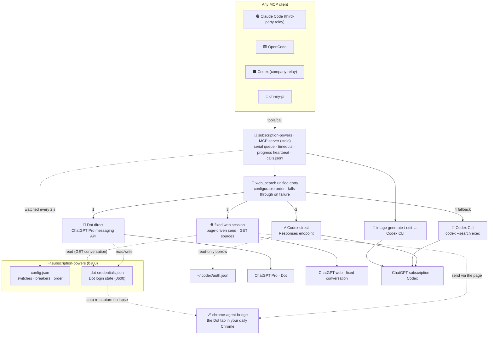

<div align="center">

# 🔌 subscription-powers

**Turn your ChatGPT (Codex / Pro) and Claude (Claude Code) subscriptions into MCP tools any agent can call.**

Image generation · Live web search (four backends with automatic fallback) · Page fetch · Subscription-billed task runner — with zero API keys.

[](./LICENSE)
[](https://nodejs.org)
[](https://modelcontextprotocol.io)
[](https://github.com/openai/codex)
[](https://docs.anthropic.com/en/docs/claude-code)


**🌐 Language:** English · [简体中文](./README.md)

[Why](#-why) · [What's new](#-whats-new) · [Tools](#-tools) · [How it works](#%EF%B8%8F-how-it-works) · [Design ideas](#-design-ideas) · [Tech stack](#-tech-stack) · [Quick start](#-quick-start) · [CLI](#%EF%B8%8F-the-subpow-cli) · [Connect your agent](#-connect-your-agent) · [Progress & TODO](#-progress--todo) · [Troubleshooting](#-troubleshooting)

</div>

---

## 💡 Why

Subscriptions bundle capabilities that plain API relays and self-hosted models don't have:

| Capability | 🧠 OpenAI-compatible relay / local model | 🟢 ChatGPT subscription (Codex) | 🟠 Claude subscription (Claude Code) |
|---|:---:|:---:|:---:|
| 🎨 Image generation & editing (`gpt-image-2`) | ✗ | ✓ `image_gen` | ✗ |
| 🌐 Live web search | ✗ | ✓ native `web_search` | ✓ `WebSearch` |
| 📄 Server-side page fetch with cache | ✗ | – | ✓ `WebFetch` |
| 💳 Billing | per token | flat monthly | flat monthly |

**subscription-powers** exposes exactly those subscription-only powers as standard MCP tools, so *every* agent you run — OpenCode, oh-my-pi, a Codex pointed at a company relay, even a Claude Code behind a third-party relay that has **no built-in WebSearch** — can borrow them.

> [!IMPORTANT]
> **Default mode**: never reads, copies or forwards your credentials. It only spawns the official `codex` / `claude` CLIs as child processes, the way you would in a terminal; nothing talks to OpenAI or Anthropic backends directly.
>
> **Exceptions (experimental, off by default, switchable at any time)**: `dot_web_search` and `codex_api_search` **call ChatGPT's private endpoints directly**. The former uses a web login state saved under `~/.subscription-powers/` (it can be captured automatically from Chrome); the latter borrows the token in `~/.codex/auth.json` **read-only** (never refreshes or writes it back). They sit outside the official CLI's guard rails; see the Disclaimer for the terms-of-service risk.

---

## 🆕 What's new

| Stage | Change |
|---|---|
| **Latest · Fixed web session** | 🌐 `chatgpt_web_search`: you pin **one** ChatGPT web conversation and every search runs inside it (no session configured → error). It types into that page through chrome-agent-bridge and Node reads back the **structured sources** (title / URL / snippet / date, ~12 per search); does not need Pro. Off by default. Measured: quick ~14–27 s, deep ~15 s |
| **Dot route 3** | 🪄 `subpow dot capture`: grabs the login state from the Dot tab already open and logged in in your **daily Chrome**, through chrome-agent-bridge. It detaches the debugger immediately and only saves after a read-only verification. With `dot auto-capture on` a lapsed login state **heals itself** (measured: with the cookie deliberately broken, one search recovered and returned correct results in ~21 s) |
| **Unified entry** | 🧭 `web_search`: Dot → Codex direct → Codex CLI in order; switched-off backends are skipped, failures fall through, and the reply says who answered and what was tried. Order is configurable (`subpow search order`) |
| **Codex direct** | ⚡ `codex_api_search`: calls the Codex Responses endpoint directly with the hosted `web_search` forced and structured sources, ~9K input tokens (CLI ~47K). Credentials are a **read-only borrow** of `~/.codex/auth.json`; a plan or account change trips the breaker immediately |
| **Dot direct** | 🧪 `dot_web_search`: calls the ChatGPT Pro "Dot" messaging API directly; hot switch + automatic circuit breaker (Pro may lapse, so one command turns it off); cross-process lock so concurrent sessions don't cross wires |
| **Search modes & logging** | 🔎 `mode: quick \| deep` (quick returns a title / URL / summary list); the server writes `calls.jsonl` with queue time, run time, model, usage, errors |
| **Start** | 🎨 image generate / edit, 🔎 Codex search, 🌐 Claude search & fetch, 🤖 `codex_run` / `claude_run` (`claude_*` is now off by default) |

---

## 🧰 Tools

| Tool | Backend | What it does |
|---|---|---|
| 🎨 `codex_generate_image` | `codex exec` → built-in `image_gen` | Generate a PNG (1024², 1536×1024, 1024×1536). Style hints, transparent background, reference image. |
| ✂️ `codex_edit_image` | `codex exec` → `image_gen` edit | Edit an existing image with a natural-language instruction; optional mask. |
| 🧭 `web_search` | Unified entry | **Call this one.** Tries Dot → Codex direct → Codex CLI in order, skips backends that are off and falls through on failure; the reply carries `backend`, `attempts`, `skipped`. The `backends` argument overrides the order per call. Same result shape as the backends |
| 🔎 `codex_web_search` | `codex --search exec` | OpenAI native `web_search` inside Codex; always available (the last fallback of the unified entry). `mode: "quick"` (default, `gpt-6-luna`/medium): a list of title / URL / one-line summary. `mode: "deep"` (`gpt-6.1-sol`/medium): several searches, a written answer + sources. |
| ⚡ `codex_api_search` | Calls the Codex Responses endpoint directly | **Experimental, off by default.** No subprocess; OpenAI's hosted `web_search` is forced. `quick` (`gpt-6-luna`/low) returns `{title, url, summary}` plus other consulted URLs, `deep` (`gpt-6.1-sol`/medium) writes an answer + citations. `subpow codex on/off/status` |
| 🌐 `chatgpt_web_search` | Drives a **fixed ChatGPT web conversation** (types into the page via chrome-agent-bridge, reads structured sources back) | **Experimental, off by default.** Run `subpow web session set <conversation URL>` first — unconfigured is an error; Chrome must have that conversation open and visible; uses whatever model the page has selected. `quick` returns `{title, url, summary, published}`, `deep` writes an answer + sources; it posts real messages into that conversation. `subpow web on/off/status` |
| 🧪 `dot_web_search` | Calls the ChatGPT Pro "Dot" messaging API directly | **Experimental, off by default.** `quick` returns `{title, url, summary}`, `deep` writes an answer + sources; it posts real messages into your Dot chat. `subpow dot on/off/status` |
| 🌐 `claude_web_search` | `claude -p` + `WebSearch`/`WebFetch` | Anthropic-side search. Answer + sources + list-price cost + turn count. |
| 📄 `claude_web_fetch` | `claude -p` + `WebFetch` | Fetch one URL (server-side, 15-min cache) and answer a question about it. |
| 🤖 `codex_run` | `codex exec` | Run an arbitrary task on the subscription GPT model (read-only sandbox by default). |
| 🧑‍💻 `claude_run` | `claude -p` | Run an arbitrary task on the subscription Claude model (read-only tools by default). |

> [!NOTE]
> The three `claude_*` tools are **not registered by default**. If you have a Claude subscription, set `SUBPOW_ENABLE_CLAUDE=1` in the MCP server's env. `dot_web_search` / `codex_api_search` also **disappear from the tool list** while switched off or tripped (see the hot switch below).

Every result is JSON: `ok`, the payload, `elapsed_ms`, `queued_ms` (queue wait), and usage (`tokens` for Codex, `cost_usd_list_price` and `turns` for Claude), so callers can budget.

---

## ⚙️ How it works



---

## 🧠 Design ideas

<table>
<tr><td width="50%" valign="top">

### 🔘 Hot-pluggable tools
Subscriptions lapse and Pro may not be renewed, so a backend must be killable with one command. The switch lives in a config file the MCP process watches every 2 s; on change it calls the SDK's `enable()/disable()` and clients get `tools/list_changed` — **no session restart**. A switched-off tool vanishes from the list instead of lingering as an entry that errors.

</td><td width="50%" valign="top">

### 🚨 A breaker that trips by itself
Three consecutive "login lapsed / blocked by Cloudflare / token rejected" failures switch the backend off and record why. Network blips, rate limits, 5xx and timeouts **don't count**. Codex direct also records the **plan and account** at the moment you enable it; if the token's `plan` later changes (say Pro → Plus) it trips immediately instead of waiting for three failures.

</td></tr>
<tr><td valign="top">

### 🔒 Read-only borrowing
`codex_api_search` never refreshes or writes `~/.codex/auth.json` (a refresh rotates the refresh token and could log the Codex CLI out). An expired token yields `codex_api_token_expired` and the next backend takes over. A test asserts the file's content and mtime are unchanged after success and failure, and a mutation test confirmed that test really can fail.

</td><td valign="top">

### 🧵 One room, many sessions
A Dot account has exactly **one** chat room, while every agent session has its own MCP process. A cross-process file lock serializes them, each request carries a random end marker `[[END:xxxxxx]]` to match its reply, and replies are told apart by `account_user_id` (both sides have `role: user`). Two processes searching at once did not cross wires.

</td></tr>
<tr><td valign="top">

### 🪄 Your daily Chrome as the login source
No second Chrome, no manual HAR export: through chrome-agent-bridge we attach to the Dot tab you're **already logged in on** and only listen to network events — the page's own requests already carry the Bearer token, cookies and device id. **Raw events contain secrets and are handled only inside our own Node process, never through the model transcript**; the debugger is detached right after, and nothing is saved until verification passes.

</td><td valign="top">

### 🩹 Self-healing
With `auto-capture` on, a lapsed login makes a search re-capture once and retry the same request (with a cooldown so the debugger isn't attached repeatedly). If re-capture fails the original error is returned and counted toward the breaker — **a failed heal never masks the fault**.

</td></tr>
<tr><td valign="top">

### 🧭 One entry, honest replies
Callers need only `web_search`. It tries backends in order and reports `backend` (who answered), `attempts` (what failed and why) and `skipped` (what was off). When nothing is available you get an aggregate error, not a made-up empty result.

</td><td valign="top">

### ✅ Don't trust what the model says
Codex direct requires a real `web_search_call` in the stream, otherwise it's `no_search` (the model answered from memory); sources come from the structured `action.sources`, not from links the model chose to list. Image generation is verified with `stat` on the saved file rather than trusting a `SAVED` line.

</td></tr>
</table>

### 🖱️ Drive the page instead of cracking the check
The web chat's send endpoint requires three checks (proof-of-work, a human-verification token, a session observer). We tested "build the request ourselves with the page SDK's tokens" — the server answered 403 `Unusual activity`, so we **stopped** rather than reverse the check bytecode, and let the page send instead: type into the message box, press Enter, the page does the checks; reading the result is a plain GET. It **refuses to overwrite** an unsent draft in the box, and if the message never shows up it clears the text it typed so it can't linger as a draft blocking the next call.

A few more rules that keep it boring but safe:

- 🧼 **Scrubbed environment.** Child processes get an environment with `CLAUDECODE`, `CLAUDE_CODE_*`, `CLAUDE_CONFIG_DIR`, `ANTHROPIC_*`, `CODEX_HOME` and relay API keys stripped, so the CLIs always run under your **personal** `~/.codex` and `~/.claude`.
- 🚦 **One in flight per backend** (Codex direct defaults to 2). Cold starts and quotas don't survive concurrency.
- ⏱️ **Timeouts with teeth.** SIGTERM, then SIGKILL; long jobs send an MCP `notifications/progress` heartbeat every 8 s.
- 🗂️ **Files, not blobs.** Images go to a directory you choose and are verified server-side.
- 🛡️ **Path guard.** Absolute paths only, and never inside `~/.codex`, `~/.claude`, `~/.ssh`, `~/.aws`, etc.
- 🙈 **No secrets in logs or the repo.** State dir 0700, files 0600; `calls.jsonl` records only timings, models, usage and error codes.

---

## 🧱 Tech stack

| Layer | Choice |
|---|---|
| Runtime |  plain ESM (`.mjs`), no build step |
| Protocol |  `@modelcontextprotocol/sdk` (server + client), `zod` for input validation |
| Backend · CLI |  `codex exec` / `--search` / `--output-schema`; optionally  `claude -p` |
| Backend · direct | ChatGPT private endpoints: Codex Responses (SSE, `web_search` forced), Dot messaging (polling + end marker) |
| Login capture | chrome-agent-bridge (local MCP) + Chrome DevTools Protocol (`Network.*` events) |
| Concurrency & resilience | in-process serial queue, cross-process file lock (`wx` exclusive create + heartbeat), exponential backoff, `Retry-After` budget |
| State | `~/.subscription-powers/` (atomic writes, 0600/0700), `fs.watchFile` hot reload |
| Tests |  built-in runner, fully offline (fake fetch / fake bridge / temp state dir) |

---

## 🚀 Quick start

**Prerequisites**

- Node.js ≥ 20
- `codex` CLI installed and logged in with your ChatGPT account (`codex login`)
- (optional) `claude` CLI installed and logged in with a Claude subscription
- (optional, Dot auto-capture only) chrome-agent-bridge on this machine and a logged-in Dot page open in Chrome

```bash
git clone https://github.com/we1005/subscription-powers-mcp.git
cd subscription-powers-mcp/server
npm install

npm test                                         # 61 offline unit tests
npm run smoke                                    # list tools + one cheap call
node tests/smoke.mjs --full                      # actually run every tool (generates an image, spends subscription quota)
node tests/smoke.mjs --only=codex_web_search     # pick a few
```

**Turn on the experimental backends** (all off by default)

```bash
# ⚡ Codex direct: borrows ~/.codex/auth.json (read-only)
npm run subpow -- codex on --live        # --live sends one minimal real request to verify

# 🌐 Fixed web session: pin the conversation URL first (required; stored in ~/.subscription-powers/config.json) and keep that page open in Chrome
npm run subpow -- web session set 'https://chatgpt.com/g/g-p-…/c/<conversation id>'   # verified on the spot: readable, not archived
npm run subpow -- web on                 # shares the login state with Dot (run dot capture once first)

# 🧪 Dot: capture the login state first (a logged-in Dot page open in Chrome), then enable
npm run subpow -- dot capture --dry-run  # verify only, save nothing
npm run subpow -- dot capture            # capture and save
npm run subpow -- dot on                 # health check first; only enables if it passes
npm run subpow -- dot auto-capture on    # optional: re-capture automatically when the login lapses

npm run subpow -- search status          # which backends the unified entry can use right now
```

---

## 🛠️ The `subpow` CLI

`node server/bin/subpow.mjs <area> <command>`, or `npm run subpow -- <area> <command>` inside `server/`. Running MCP processes react to switch changes within 2 s.

| Command | Does |
|---|---|
| `dot status` | switch, breaker, login-state expiry, auto-capture state, recent calls |
| `dot on [--force]` / `off` / `reset` | enable (after a health check) / disable / clear the breaker |
| `dot check` | refresh the token and read one message, sends nothing |
| `dot capture [--dry-run] [--open] [--browser X]` | 🪄 capture the login state from your daily Chrome; `--dry-run` verifies without saving |
| `dot auto-capture on\|off` | re-capture automatically when the login lapses (off by default; Chrome briefly shows the "being debugged" bar) |
| `dot import-har <file>` | manual route: import the login state from a HAR |
| `dot search "<query>" [--mode deep]` | search directly (posts a real message) |
| `web session set <url>` / `show` / `clear` | fixed web session: pin / show / clear (verified when set) |
| `web status` / `on` / `off` / `reset` / `check` | switch, breaker and health check for the fixed-session search |
| `web search "<query>" [--mode deep]` | search directly (posts a real message into the fixed conversation) |
| `codex status` / `on [--live]` / `off` / `reset` / `check [--live]` | Codex direct switch and health check |
| `codex search "<query>" [--mode deep] [--model M] [--effort E]` | search directly |
| `search status` / `order dot,codex_api,chatgpt_web,codex_cli` / `run "<query>"` | unified entry: status, reorder, run |

---

## 🔗 Connect your agent

<details open>
<summary><b>🟠 Claude Code</b></summary>

```bash
claude mcp add --scope user subscription-powers -- node /absolute/path/to/subscription-powers-mcp/server/index.mjs
```
For a second config dir: `CLAUDE_CONFIG_DIR=… claude mcp add …`.
</details>

<details>
<summary><b>🟩 OpenCode</b> — <code>~/.config/opencode/opencode.json</code></summary>

```jsonc
{
  "mcp": {
    "subscription-powers": {
      "type": "local",
      "command": ["node", "/absolute/path/to/subscription-powers-mcp/server/index.mjs"],
      "enabled": true
    }
  }
}
```
</details>

<details>
<summary><b>⬛ Codex CLI</b> — <code>~/.codex/config.toml</code> (or any <code>CODEX_HOME</code>)</summary>

```toml
[mcp_servers.subscription-powers]
command = "node"
args = ["/absolute/path/to/subscription-powers-mcp/server/index.mjs"]
default_tools_approval_mode = "approve"   # tools are read-only except the image files you ask for
startup_timeout_sec = 30
tool_timeout_sec = 600
```
Yes — a Codex pointed at a company relay can borrow your **personal** Codex's image generation this way.
</details>

<details>
<summary><b>🥧 oh-my-pi</b> — <code>~/.omp/agent/mcp.json</code></summary>

```json
{
  "mcpServers": {
    "subscription-powers": {
      "command": "node",
      "args": ["/absolute/path/to/subscription-powers-mcp/server/index.mjs"]
    }
  }
}
```
</details>

---

## 💸 Cost & latency

Measured locally (ChatGPT Plus / Pro, macOS); varies with models and the backend:

| Tool | Typical time | Typical cost |
|---|---|---|
| 🎨 `codex_generate_image` | 45–90 s | ~25–90K tokens (mostly cache hits) · ~1 % of a Plus 5-hour window → roughly **300–500 images/week** |
| 🔎 `codex_web_search` (CLI) | quick 15–25 s · deep 30–60 s | ~40–50K input tokens (~20–30K cached), mostly the CLI's own system prompt |
| ⚡ `codex_api_search` | no CLI cold start | ~**9K** input tokens (about 1/5 of the CLI) |
| 🌐 `chatgpt_web_search` | quick ~14–27 s · deep ~15 s (queued when concurrent; the second of two simultaneous calls waited 16 s) | counts against the account's message quota (limit not checked); does not need Pro |
| 🧪 `dot_web_search` | quick / deep ~15–20 s (more if queued) | not counted against Codex quota; whether Pro's Dot is truly unlimited is **unverified** |
| 🌐 `claude_web_search` | 30–40 s | 4–5 turns · ~$0.4 list price (needs `claude_*` enabled) |
| 📄 `claude_web_fetch` | ~12 s | ~$0.3 list price (needs `claude_*` enabled) |

The CLI backends pay a 5–10 s cold start per call; batch related questions. For lower latency and cost, enable `codex_api_search`.

---

## 📈 Progress & TODO

### Done

| Module | Status | Notes |
|---|:---:|---|
| Image generate / edit | ✅ | Codex CLI, saved file verified with `stat` |
| Codex CLI search quick / deep | ✅ | structured output, source list, `queued_ms` |
| Server-side call log | ✅ | `~/.cache/subscription-powers/calls.jsonl` |
| Fixed web session `chatgpt_web_search` | ✅ | page-driven send, structured sources; off by default; verified live: quick / deep / concurrency / hot switch |
| Dot direct (route 1) | ✅ | no Sentinel token needed; hot switch, breaker, cross-process lock |
| Codex direct `codex_api_search` | ✅ | read-only credentials; plan/account-bound breaker; retries and rate-limit budget |
| Unified entry `web_search` | ✅ | configurable order, fallback, honest replies |
| Dot login auto-capture (route 3) | ✅ | `dot capture` + auto re-capture, self-heal verified live |
| Unit tests | ✅ | 61, all offline |
| Docs & third-party attribution | ✅ | see the doc index below and `THIRD_PARTY_NOTICES.md` |

### To do (full list and details in [`TODO.md`](./TODO.md), in Chinese)

- [ ] **Plan A: own OAuth login** (`subpow codex login`) — deferred. Today we borrow `~/.codex/auth.json`; if you don't use Codex for a long time the token expires and the unified entry falls back to the CLI
- [ ] **Route 2: dedicated Chrome + CDP** — deferred; direct calls aren't blocked by Cloudflare, so it isn't needed yet
- [ ] Observe the real behavior after **Pro lapses** (currently an inference: plan change trips at once / three 401·403s trip)
- [ ] Show the `wham/usage` quota windows in `status` and find out whether searches count against them
- [ ] Dot: SSE instead of polling, plan-change trip, automatic first capture when no credentials file exists
- [ ] Fixed web session: the model can't be chosen by the request (uses the page's current selection); the fixed conversation keeps growing, so a "rotate to a new session" hint could follow; the message box is located by structure, not by UI text, but a redesign could still break it
- [ ] Long-lived Codex session (`codex mcp-server` / Agent SDK) to remove CLI cold starts
- [ ] Return small thumbnails inline as MCP image content; `codex_generate_image_set` for style-consistent batches
- [ ] Optionally add the local searxng as the unified entry's last fallback

### Not yet verified (the honest list)

- Behavior after Pro lapses; Dot being "unlimited"; whether searches count against Codex's `wham/usage`
- Whether running the Codex CLI fallback also refreshes `~/.codex/auth.json`
- Whether headers such as `version` / `originator` stay accepted by the private endpoints

---

## 🩺 Troubleshooting

| Symptom | Meaning | Fix |
|---|---|---|
| `codex_not_authed` / `claude_not_authed` | CLI not logged in | Run `codex login` / `claude` once in a terminal |
| `codex_timeout` | Complex image or slow network | Raise `timeout_ms` (max 600 s) |
| `no_image_saved` | Model broke the `SAVED` contract, or content policy refused | Read `last_message` in the result and rephrase |
| **Client-side** `MCP error -32001: Request timed out` | Client default of 60 s | Enable `resetTimeoutOnProgress` or raise the client's tool timeout; the server already heartbeats |
| `dot_web_search` / `codex_api_search` missing from the tool list | Switched off, or tripped | `subpow dot status` / `codex status` shows why; fix it, `reset`, then `on` |
| `chatgpt_web_no_session` | No fixed session pinned | `subpow web session set <conversation URL>` |
| `chatgpt_web_no_tab` / `chatgpt_web_composer_busy` | The conversation isn't open in Chrome / there's an unsent draft in its message box | Open it and keep it visible; clear the draft (this backend never overwrites your draft) |
| `chatgpt_web_send_failed` / `chatgpt_web_ui_changed` | The message never appeared / the message box wasn't found | Keep the page visible and not busy generating something else; repeated failures trip the breaker |
| `dot_unavailable` / `dot_blocked` | Dot login lapsed, or blocked by Cloudflare | `subpow dot capture` (needs a logged-in Dot page in Chrome), or turn on `dot auto-capture on` |
| `dot_capture_no_tab` / `dot_capture_no_auth` | No Dot tab found, or that page isn't logged in | Open and log in to the Dot page in Chrome, wait a few seconds, retry |
| `codex_api_token_expired` | The token in `~/.codex/auth.json` expired (the read-only borrow never refreshes) | Use the Codex CLI or app once so it refreshes; the unified entry falls back to the CLI meanwhile |
| Breaker tripped with `plan_changed` / `account_changed` | The token's plan or account changed | Confirm, then `subpow codex on` to re-bind |
| `shell_commands_used > 0` in a search result | Codex ran commands instead of `web_search` | Harmless, just slower; the prompt forbids it |
| Want per-call timing and usage | Server log | `~/.cache/subscription-powers/calls.jsonl`: one line per call with `queued_ms`, `run_ms`, model, usage, errors |

---

## 📚 Docs

Most design notes are in Chinese.

| Document | Content |
|---|---|
| [`docs/analysis-and-plan.zh.md`](./docs/analysis-and-plan.zh.md) | Original research and trade-offs |
| [`docs/oh-my-pi-codex-websearch.zh.md`](./docs/oh-my-pi-codex-websearch.zh.md) | How oh-my-pi uses the Codex subscription's web_search |
| [`docs/parallel-search-failure-analysis.zh.md`](./docs/parallel-search-failure-analysis.zh.md) | Static analysis of the parallel-search failures |
| [`docs/dot-websearch-design.zh.md`](./docs/dot-websearch-design.zh.md) | Dot search design and implementation (§11) |
| [`docs/dot-direct-api-implementation-log.zh.md`](./docs/dot-direct-api-implementation-log.zh.md) | Dot direct: process, difficulties, fixes (§9: route-3 auto-capture) |
| [`docs/chatgpt-session-websearch-plan.zh.md`](./docs/chatgpt-session-websearch-plan.zh.md) | Fixed web session search: analysis, P0 validation (hybrid route rejected), implementation results (§13) |
| [`docs/codex-oauth-websearch-plan.zh.md`](./docs/codex-oauth-websearch-plan.zh.md) | Codex direct plan, options A/B and measured results |
| [`TODO.md`](./TODO.md) | To-do list |

## 🙏 Credits

- The prompt contract and error taxonomy borrow from [colin-automates/Codex-ImageGen--Claude-Code](https://github.com/colin-automates/Codex-ImageGen--Claude-Code) (MIT).
- Codex direct search (`codex_api_search`) adapts request construction, SSE parsing, source cleanup and error classification from [can1357/oh-my-pi](https://github.com/can1357/oh-my-pi) (MIT); attribution and the full license text are in [`THIRD_PARTY_NOTICES.md`](./THIRD_PARTY_NOTICES.md).
- Built on the [Model Context Protocol TypeScript SDK](https://github.com/modelcontextprotocol/typescript-sdk).

## ⚠️ Disclaimer

Use within the terms of your OpenAI and Anthropic subscriptions. The default mode merely automates the official CLIs and doesn't bypass any limit; heavy image generation will burn through your plan's quota quickly.

The experimental backends (`dot_web_search`, `codex_api_search`, `chatgpt_web_search`) call **undocumented private endpoints**, `codex_api_search` reuses the Codex CLI's client protocol, `dot capture` reads request headers from a page you're logged in to in your browser, and `chatgpt_web_search` operates the ChatGPT page in your browser to send messages (during validation, one attempt to build the request ourselves was rejected by the server as "Unusual activity"). Such use may violate the terms of service, may be rate-limited or require re-verification, and in the worst case could affect your account; the endpoints can also change at any time. That's why they're off by default and trip automatically after repeated failures or a plan/account change. Whether to enable them is your call.

<div align="center"><sub>Built with the subscriptions I was already paying for.</sub></div>
