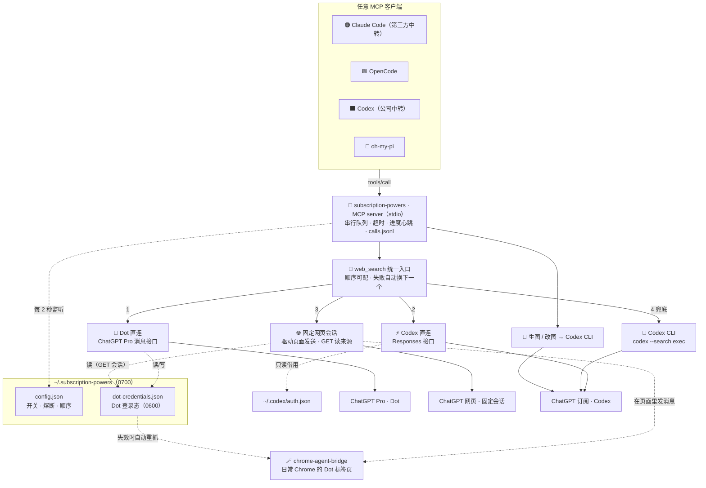

<div align="center">

# 🔌 subscription-powers

**把你的 ChatGPT（Codex / Pro）与 Claude（Claude Code）订阅变成任何 Agent 都能调用的 MCP 工具。**

生图 · 联网搜索（四条后端自动兜底）· 网页抓取 · 订阅额度跑任务 —— 全程零 API Key。

[](./LICENSE)
[](https://nodejs.org)
[](https://modelcontextprotocol.io)
[](https://github.com/openai/codex)
[](https://docs.anthropic.com/en/docs/claude-code)


**🌐 语言：** 简体中文 · [English](./README.en.md)

[为什么](#-为什么) · [更新日志](#-更新日志) · [工具](#-工具) · [工作原理](#%EF%B8%8F-工作原理) · [设计思路](#-独特的设计思路) · [技术栈](#-技术栈) · [快速开始](#-快速开始) · [命令行](#%EF%B8%8F-命令行-subpow) · [接入你的-agent](#-接入你的-agent) · [进度与待办](#-进度与待办) · [排错](#-排错)

</div>

---

## 💡 为什么

订阅里捆着一些普通 API 中转和本地模型给不了的能力：

| 能力 | 🧠 OpenAI 兼容中转 / 本地模型 | 🟢 ChatGPT 订阅（Codex） | 🟠 Claude 订阅（Claude Code） |
|---|:---:|:---:|:---:|
| 🎨 生图 / 改图（`gpt-image-2`） | ✗ | ✓ 内置 `image_gen` | ✗ |
| 🌐 实时联网搜索 | ✗ | ✓ 原生 `web_search` | ✓ `WebSearch` |
| 📄 服务端网页抓取（带缓存） | ✗ | – | ✓ `WebFetch` |
| 💳 计费方式 | 按 token | 月费包干 | 月费包干 |

**subscription-powers** 把这几样"只有订阅才有"的能力原样暴露成标准 MCP 工具，于是你手头的每一个 Agent —— OpenCode、oh-my-pi、接了公司中转的 Codex、甚至接了第三方中转而**没有内置 WebSearch 的 Claude Code** —— 都能借用。

> [!IMPORTANT]
> **默认模式**：不读、不复制、不转发任何凭据，只像你在终端里那样起官方的 `codex` / `claude` 子进程，没有任何代码直接连接 OpenAI 或 Anthropic 的后端。
>
> **例外（实验性、默认关闭、可随时开关）**：`dot_web_search` 与 `codex_api_search` 会**直接请求 ChatGPT 的私有接口**。前者读取你保存在 `~/.subscription-powers/` 里的网页登录态（可经 Chrome 自动抓取）；后者**只读**借用 `~/.codex/auth.json` 里的令牌（从不刷新、不写回）。它们不在官方 CLI 的保护之内，条款风险见下方「声明」。

---

## 🆕 更新日志

| 阶段 | 内容 |
|---|---|
| **最新 · 固定网页会话** | 🌐 `chatgpt_web_search`：你指定**一个** ChatGPT 网页会话，之后所有搜索都在这个会话里进行（没指定就报错）。经 chrome-agent-bridge 在该页面里发消息，Node 读回**结构化来源**（标题 / 网址 / 摘要 / 日期，一次 12 条左右）；不依赖 Pro。默认关闭。实测 quick 约 14–27 s、deep 约 15 s |
| **Dot 路线 3** | 🪄 `subpow dot capture`：经 [chrome-agent-bridge](#-技术栈) 从**日常 Chrome** 里已登录的 Dot 标签页自动抓取登录态，抓完立即分离调试器、只读验证后才保存。`dot auto-capture on` 后登录态失效会**自愈**（实测：故意弄坏 Cookie，一次搜索约 21 秒自动恢复并给出正确结果） |
| **统一入口** | 🧭 `web_search`：Dot → Codex 直连 → Codex CLI 按序尝试，关着的跳过、失败的换下一个，返回里写明谁回答、试过谁。顺序可改（`subpow search order`） |
| **Codex 直连** | ⚡ `codex_api_search`：直接请求 Codex Responses 接口，强制托管 `web_search`、来源是结构化字段，输入约 9K token（CLI 约 4.7 万）。凭据**只读借用** `~/.codex/auth.json`；套餐或账号一变立即熔断 |
| **Dot 直连** | 🧪 `dot_web_search`：直接调用 ChatGPT Pro「Dot」的消息接口；热开关 + 自动熔断（Pro 将来可能不续费，所以一条命令就能关）；跨进程锁，多会话同时搜索不串线 |
| **搜索模式与日志** | 🔎 `mode: quick \| deep`（quick 返回「标题 / URL / 摘要」列表）；服务端写 `calls.jsonl`，含排队时间、运行时间、模型、用量、错误 |
| **起步** | 🎨 生图 / 改图、🔎 Codex 搜索、🌐 Claude 搜索与抓取、🤖 `codex_run` / `claude_run`（`claude_*` 现默认关闭） |

---

## 🧰 工具

| 工具 | 底层 | 作用 |
|---|---|---|
| 🎨 `codex_generate_image` | `codex exec` → 内置 `image_gen` | 生成 PNG（1024²、1536×1024、1024×1536），支持风格提示、透明底、参考图 |
| ✂️ `codex_edit_image` | `codex exec` → `image_gen` 编辑 | 用自然语言修改已有图片，可选遮罩 |
| 🧭 `web_search` | 统一入口 | **推荐调用这个。** 按 Dot → Codex 直连 → Codex CLI 的顺序尝试，未开启的跳过、失败就换下一个；返回里有 `backend`、`attempts`、`skipped`。`backends` 参数可单次指定顺序。结果结构与各后端一致 |
| 🔎 `codex_web_search` | `codex --search exec` | Codex 内的 OpenAI 原生 `web_search`，永远可用（统一入口的最后兜底）。`mode: "quick"`（默认，`gpt-6-luna`/medium）返回「标题 / URL / 一句话摘要」列表；`mode: "deep"`（`gpt-6.1-sol`/medium）多次搜索并写综合回答 + 来源 |
| ⚡ `codex_api_search` | 直接请求 Codex Responses 接口 | **实验性，默认关闭。** 不起子进程，强制使用 OpenAI 托管的 `web_search`。`quick`（`gpt-6-luna`/low）返回 `{标题, URL, 摘要}` 加其他来源 URL，`deep`（`gpt-6.1-sol`/medium）写回答 + 引用。`subpow codex on/off/status` |
| 🌐 `chatgpt_web_search` | 驱动**固定的 ChatGPT 网页会话**（经 chrome-agent-bridge 在页面里发消息，读回结构化来源） | **实验性，默认关闭。** 必须先 `subpow web session set <会话网址>`，没配置就报错；需要 Chrome 开着该会话页面并保持可见；用页面当前选的模型。`quick` 返回 `{标题, URL, 摘要, 日期}`，`deep` 写回答 + 来源；会向该会话发真实消息。`subpow web on/off/status` |
| 🧪 `dot_web_search` | 直接调用 ChatGPT Pro「Dot」的消息接口 | **实验性，默认关闭。** `quick` 返回 `{标题, URL, 摘要}`，`deep` 写回答 + 来源；会向你的 Dot 发真实消息。`subpow dot on/off/status` |
| 🌐 `claude_web_search` | `claude -p` + `WebSearch`/`WebFetch` | Anthropic 侧搜索，返回答案 + 来源 + 标价成本 + 轮数 |
| 📄 `claude_web_fetch` | `claude -p` + `WebFetch` | 抓取一个 URL（服务端抓取、15 分钟缓存）并回答关于它的问题 |
| 🤖 `codex_run` | `codex exec` | 用订阅的 GPT 模型跑任意任务（默认只读沙箱） |
| 🧑‍💻 `claude_run` | `claude -p` | 用订阅的 Claude 模型跑任意任务（默认只读工具） |

> [!NOTE]
> `claude_*` 三个工具**默认不注册**。有 Claude 订阅时，在 MCP 配置里加环境变量 `SUBPOW_ENABLE_CLAUDE=1` 开启。`dot_web_search` / `codex_api_search` 关闭或熔断时也**不出现在工具列表里**（见下文热开关）。

每个结果都是 JSON：`ok`、负载、`elapsed_ms`、`queued_ms`（排队），以及用量（Codex 给 `tokens`，Claude 给 `cost_usd_list_price` 与 `turns`），调用方可以据此掂量额度。

---

## ⚙️ 工作原理



---

## 🧠 独特的设计思路

<table>
<tr><td width="50%" valign="top">

### 🔘 会热插拔的工具
订阅会过期，Pro 将来可能不续费，所以后端必须能**一条命令关掉**。开关写在配置文件里，MCP 进程每 2 秒监听；变化时用 SDK 的 `enable()/disable()`，客户端自动收到 `tools/list_changed`，**不用重启会话**。关闭后工具直接从列表里消失，而不是留着一个会报错的入口。

</td><td width="50%" valign="top">

### 🚨 会自己跳闸的熔断器
连续 3 次「登录失效 / 被 Cloudflare 拦 / 令牌被拒」就自动关掉该后端并写明原因。网络抖动、限流、5xx、超时**不计数**。Codex 直连还把**套餐与账号**记在开启那一刻，之后令牌里的 `plan` 变了（比如 Pro → Plus）立即熔断——不用等失败三次。

</td></tr>
<tr><td valign="top">

### 🔒 只读借用，不碰别人的登录
`codex_api_search` 从不刷新、不写回 `~/.codex/auth.json`（刷新会轮换刷新令牌，可能把 Codex CLI 登出）。令牌过期就报 `codex_api_token_expired` 并交给下一个后端。测试断言成功与失败之后登录文件的内容和修改时间都不变，并用变异测试确认这条测试真的会失败。

</td><td valign="top">

### 🧵 一个房间，多个会话
Dot 账号只有**一个**对话房间，而每个 Agent 会话都有自己的 MCP 进程。我们用跨进程文件锁串行化，每条请求带随机结束标记 `[[END:xxxxxx]]` 对应回复，回复通过 `account_user_id` 区分（两边的 `role` 都是 `user`）。实测两进程并发不串线。

</td></tr>
<tr><td valign="top">

### 🪄 日常 Chrome 当登录态来源
不另起一个 Chrome、也不要你手动导出 HAR：经 chrome-agent-bridge 附加到你**已登录**的 Dot 标签页，只听网络事件，页面自己发出的请求里就有 Bearer、Cookie、设备号。**原始事件含机密，只在我们自己的 Node 进程里处理，从不经过模型对话**；抓完立刻分离调试器，验证通过才落盘。

</td><td valign="top">

### 🩹 失效自愈
开启 `auto-capture` 后，搜索遇到登录态失效会自动重抓一次并重试同一个请求（有冷却，不会反复附加调试器）。重抓失败就原样返回原来的错误并照常计入熔断——**自愈失败不会掩盖故障**。

</td></tr>
<tr><td valign="top">

### 🧭 统一入口 + 诚实的返回
调用方只需要一个 `web_search`。它按顺序试后端，返回里写明 `backend`（谁答的）、`attempts`（失败过的和原因）、`skipped`（因为关着而跳过的）。没有任何后端可用时给出汇总错误，而不是编一个空结果。

</td><td valign="top">

### ✅ 不信模型说的
Codex 直连要求回复里**真的出现了 `web_search_call`**，否则判为 `no_search`（模型没搜、凭记忆答了）；来源取自结构化的 `action.sources`，而不是让模型自己列链接。生图则用 `stat` 核验落盘文件，不信 `SAVED` 这一句话。

</td></tr>
</table>

### 🖱️ 遇到校验就驱动页面，不去破解
网页聊天的发送接口要过三道校验（算力题、人机校验、会话观察者）。我们实测过"用页面 SDK 的令牌自己发请求"——被 403 `Unusual activity` 拒绝，于是**停手**，没有去解校验字节码，而是改成让页面自己发：往输入框填字、按回车，校验由页面完成；读回结果只是普通的 GET。输入框里有未发送的草稿时**拒绝覆盖**；发送后消息始终没出现就清掉填进去的字，免得留成草稿挡住下一次。

另外几条让它"无聊但安全"的规则：

- 🧼 **清洗环境。** 子进程拿到的环境里 `CLAUDECODE`、`CLAUDE_CODE_*`、`CLAUDE_CONFIG_DIR`、`ANTHROPIC_*`、`CODEX_HOME`、中转 API Key 全部剥掉，CLI 永远在你**个人**的 `~/.codex` 与 `~/.claude` 下运行。
- 🚦 **每个后端同时只跑一个**（Codex 直连默认并发 2）。冷启动和额度都经不起并发。
- ⏱️ **有牙齿的超时。** 先 SIGTERM 再 SIGKILL；长任务每 8 秒发一次 MCP `notifications/progress` 心跳。
- 🗂️ **落文件，不传大块。** 图片保存到你指定的目录，服务端核验。
- 🛡️ **路径守卫。** 只接受绝对路径，且不允许写进 `~/.codex`、`~/.claude`、`~/.ssh`、`~/.aws` 等目录。
- 🙈 **机密不进日志、不进仓库。** 状态目录 0700、文件 0600；`calls.jsonl` 只记耗时、模型、用量、错误码。

---

## 🧱 技术栈

| 层 | 选型 |
|---|---|
| 运行时 |  纯 ESM（`.mjs`），无构建步骤 |
| 协议 |  `@modelcontextprotocol/sdk`（服务端 + 客户端）、`zod` 校验入参 |
| 后端 · CLI |  `codex exec` / `--search` / `--output-schema`；可选  `claude -p` |
| 后端 · 直连 | ChatGPT 私有接口：Codex Responses（SSE，`web_search` 强制）、Dot messaging（轮询 + 结束标记） |
| 登录态抓取 | chrome-agent-bridge（本机 MCP） + Chrome DevTools Protocol（`Network.*` 事件） |
| 并发与稳定 | 进程内串行队列、跨进程文件锁（`wx` 独占创建 + 心跳）、指数退避、`Retry-After` 预算 |
| 状态 | `~/.subscription-powers/`（原子写、0600/0700）、`fs.watchFile` 热加载 |
| 测试 |  内置测试运行器，全部离线（假 fetch / 假 bridge / 临时状态目录） |

---

## 🚀 快速开始

**前提**

- Node.js ≥ 20
- 已安装 `codex` CLI 并用 ChatGPT 账号登录（`codex login`）
- （可选）已安装 `claude` CLI 并用 Claude 订阅登录
- （可选，仅 Dot 自动抓取）本机装了 chrome-agent-bridge，且 Chrome 里开着一个已登录的 Dot 页面

```bash
git clone https://github.com/we1005/subscription-powers-mcp.git
cd subscription-powers-mcp/server
npm install

npm test                                         # 61 个离线单元测试
npm run smoke                                    # 列出工具 + 一次便宜的调用
node tests/smoke.mjs --full                      # 每个工具都真跑一遍（会生成一张图，消耗订阅额度）
node tests/smoke.mjs --only=codex_web_search     # 只挑几个
```

**开启实验性后端**（都默认关闭）

```bash
# ⚡ Codex 直连：借用 ~/.codex/auth.json（只读）
npm run subpow -- codex on --live        # --live 会真的发一个最小请求验证

# 🌐 固定网页会话：先指定会话网址（必填，存到 ~/.subscription-powers/config.json），Chrome 里开着该会话页面
npm run subpow -- web session set 'https://chatgpt.com/g/g-p-…/c/<会话id>'   # 当场验证：能读到、没归档
npm run subpow -- web on                 # 登录态与 Dot 共用（先 dot capture 一次）

# 🧪 Dot：先抓登录态（Chrome 里开着已登录的 Dot 页面），再开启
npm run subpow -- dot capture --dry-run  # 只验证，不保存
npm run subpow -- dot capture            # 抓取并保存
npm run subpow -- dot on                 # 先健康检查，通过才开启
npm run subpow -- dot auto-capture on    # 可选：登录态失效时自动重抓

npm run subpow -- search status          # 看统一入口现在能用哪几个后端
```

---

## 🛠️ 命令行 `subpow`

`node server/bin/subpow.mjs <区域> <命令>`，或在 `server/` 下 `npm run subpow -- <区域> <命令>`。运行中的 MCP 会在 2 秒内响应开关变化。

| 命令 | 作用 |
|---|---|
| `dot status` | 开关、熔断、登录态到期、自动重抓状态、最近调用 |
| `dot on [--force]` / `off` / `reset` | 开启（先健康检查）/ 关闭 / 清除熔断 |
| `dot check` | 续期令牌并读一条消息，不发送内容 |
| `dot capture [--dry-run] [--open] [--browser X]` | 🪄 从日常 Chrome 自动抓取登录态；`--dry-run` 只验证不保存 |
| `dot auto-capture on\|off` | 登录态失效时自动重抓（默认关，抓取时 Chrome 会短暂显示"正在被调试"） |
| `dot import-har <file>` | 手动方式：从 HAR 导入登录态 |
| `dot search "<问题>" [--mode deep]` | 直接搜索（会发真实消息） |
| `web session set <网址>` / `show` / `clear` | 固定网页会话：指定 / 查看 / 清除（设置时当场验证） |
| `web status` / `on` / `off` / `reset` / `check` | 固定网页会话搜索的开关、熔断与健康检查 |
| `web search "<问题>" [--mode deep]` | 直接搜索（会向固定会话发真实消息） |
| `codex status` / `on [--live]` / `off` / `reset` / `check [--live]` | Codex 直连的开关与健康检查 |
| `codex search "<问题>" [--mode deep] [--model M] [--effort E]` | 直接搜索 |
| `search status` / `order dot,codex_api,chatgpt_web,codex_cli` / `run "<问题>"` | 统一入口：状态、改顺序、直接跑 |

---

## 🔗 接入你的 Agent

<details open>
<summary><b>🟠 Claude Code</b></summary>

```bash
claude mcp add --scope user subscription-powers -- node /绝对路径/subscription-powers-mcp/server/index.mjs
```
第二套配置目录同理：`CLAUDE_CONFIG_DIR=… claude mcp add …`。
</details>

<details>
<summary><b>🟩 OpenCode</b> — <code>~/.config/opencode/opencode.json</code></summary>

```jsonc
{
  "mcp": {
    "subscription-powers": {
      "type": "local",
      "command": ["node", "/绝对路径/subscription-powers-mcp/server/index.mjs"],
      "enabled": true
    }
  }
}
```
</details>

<details>
<summary><b>⬛ Codex CLI</b> — <code>~/.codex/config.toml</code>（或任意 <code>CODEX_HOME</code>）</summary>

```toml
[mcp_servers.subscription-powers]
command = "node"
args = ["/绝对路径/subscription-powers-mcp/server/index.mjs"]
default_tools_approval_mode = "approve"   # 除你点名要的图片文件外，工具均为只读
startup_timeout_sec = 30
tool_timeout_sec = 600
```
没错 —— 接了公司中转的 Codex，可以这样借用你**个人** Codex 的生图能力。
</details>

<details>
<summary><b>🥧 oh-my-pi</b> — <code>~/.omp/agent/mcp.json</code></summary>

```json
{
  "mcpServers": {
    "subscription-powers": {
      "command": "node",
      "args": ["/绝对路径/subscription-powers-mcp/server/index.mjs"]
    }
  }
}
```
</details>

---

## 🧲 让模型想得起来用它

MCP 工具最常见的问题是模型"想不起来调"。三层办法，由弱到强：

1. **服务端自带使用说明（已内置，不用配置）**：服务端的 `instructions` 会被 Codex 当作该 MCP 的模型可见说明、被 Claude Code 放进系统提示，内容是"需要最新信息就先调 `web_search`，不要说自己不能上网"。
2. **工具描述写成指令**：`web_search` 的描述以"需要联网信息时调用，而不是凭记忆回答"开头。
3. **在全局指令文件里再强调一次（最稳，建议加）**：`AGENTS.md` 是每轮都注入的上下文，比 Skill 靠谱（Skill 要先匹配到描述才会加载）。

```markdown
# ~/.codex/AGENTS.md（Claude Code 则写进 ~/.claude/CLAUDE.md）
需要最新或可核实的在线信息（版本、发布、新闻、文档、价格、"最新"）时，
先调用 subscription-powers 的 `web_search`，再回答；不要凭记忆作答，也不要说无法联网。
```

> [!NOTE]
> 若宿主自带的联网搜索可用，两者并存即可；它不可用（例如走第三方中转）时，上面的说明让模型知道该转用 `web_search`。以上效果取决于模型和宿主，没有做过量化对比。

---

## 💸 成本与时延

以下为本机实测（ChatGPT Plus / Pro、macOS），随模型与服务端变化：

| 工具 | 典型耗时 | 典型成本 |
|---|---|---|
| 🎨 `codex_generate_image` | 45–90 s | 约 2.5–9 万 token（大部分命中缓存）· 约占 Plus 5 小时窗口 1 % → 粗估 **每周 300–500 张** |
| 🔎 `codex_web_search`（CLI） | quick 15–25 s · deep 30–60 s | 输入约 4–5 万 token（约 2–3 万命中缓存），主要是 CLI 自带的系统提示 |
| ⚡ `codex_api_search` | 无 CLI 冷启动 | 输入约 **9K** token（约为 CLI 的 1/5） |
| 🌐 `chatgpt_web_search` | quick 约 14–27 s · deep 约 15 s（并发时排队，实测第二个等了 16 s） | 计入账号的消息额度（未查限额）；不依赖 Pro |
| 🧪 `dot_web_search` | quick / deep 约 15–20 s（含排队则更久） | 不计 Codex 额度；Pro 的 Dot 是否真的无限**未验证** |
| 🌐 `claude_web_search` | 30–40 s | 4–5 轮 · 标价约 $0.4（需开启 `claude_*`） |
| 📄 `claude_web_fetch` | 约 12 s | 标价约 $0.3（需开启 `claude_*`） |

CLI 后端每次调用有 5–10 秒冷启动；相关问题尽量合并到一次调用里。想要更低延迟与成本，开启 `codex_api_search`。

---

## 📈 进度与待办

### 已完成

| 模块 | 状态 | 说明 |
|---|:---:|---|
| 生图 / 改图 | ✅ | Codex CLI，`stat` 核验落盘 |
| Codex CLI 搜索 quick / deep | ✅ | 结构化输出，来源列表，`queued_ms` |
| 服务端调用日志 | ✅ | `~/.cache/subscription-powers/calls.jsonl` |
| 固定网页会话 `chatgpt_web_search` | ✅ | 驱动页面发送、读结构化来源；默认关闭；已实测 quick / deep / 并发 / 热开关 |
| Dot 直连（路线 1） | ✅ | 无需 Sentinel 令牌；热开关、熔断、跨进程锁 |
| Codex 直连 `codex_api_search` | ✅ | 只读借用凭据；套餐/账号绑定熔断；重试与限流预算 |
| 统一入口 `web_search` | ✅ | 顺序可配、失败兜底、返回诚实 |
| Dot 自动抓取登录态（路线 3） | ✅ | `dot capture` + 自动重抓，已实测自愈 |
| 单元测试 | ✅ | 61 个，全部离线 |
| 文档与第三方署名 | ✅ | 见下方文档索引、`THIRD_PARTY_NOTICES.md` |

### 待办（完整清单与细节见 [`TODO.md`](./TODO.md)）

- [ ] **方案 A：自建 OAuth 登录**（`subpow codex login`）——暂缓。目前借用 `~/.codex/auth.json`，久不用 Codex 时令牌会过期，由统一入口兜底到 CLI
- [ ] **路线 2：专用 Chrome + CDP** ——暂缓，直连没被 Cloudflare 拦截，暂时不需要
- [ ] 实测 **Pro 到期**后的真实表现（现在只是推断：套餐变化立即熔断 / 401·403 连续 3 次熔断）
- [ ] `status` 展示 `wham/usage` 额度窗口，并弄清搜索是否计入
- [ ] Dot：改用 SSE 代替轮询、套餐变化即熔断、没有登录态文件时自动首抓
- [ ] 固定网页会话：模型无法由请求指定（用页面当前选择）；固定会话会越聊越长，后续可做"定期换新会话"的提示；页面语言/改版会影响输入框定位（已按结构而非文字定位）
- [ ] 长驻 Codex 会话（`codex mcp-server` / Agent SDK），省掉 CLI 冷启动
- [ ] 以 MCP image content 内联返回小缩略图；`codex_generate_image_set` 成组出图
- [ ] 视需要把本机的 searxng 加为统一入口的最后兜底

### 尚未验证（诚实清单）

- Pro 到期后的行为；Dot "额度无限"；搜索是否计入 Codex 的 `wham/usage`
- Codex CLI 兜底运行时是否会顺带刷新 `~/.codex/auth.json`
- 私有接口的 `version` / `originator` 等头是否长期被接受

---

## 🩺 排错

| 现象 | 含义 | 处理 |
|---|---|---|
| `codex_not_authed` / `claude_not_authed` | CLI 未登录 | 在终端跑一次 `codex login` / `claude` |
| `codex_timeout` | 图太复杂或网络慢 | 调大 `timeout_ms`（上限 600 s） |
| `no_image_saved` | 模型没按 `SAVED` 协定回复，或被内容策略拒绝 | 看结果里的 `last_message`，换个说法 |
| **客户端**报 `MCP error -32001: Request timed out` | 客户端默认 60 秒 | 开 `resetTimeoutOnProgress` 或调大客户端工具超时；服务端已在发心跳 |
| `dot_web_search` / `codex_api_search` 不在工具列表里 | 开关关着，或已被熔断 | `subpow dot status` / `codex status` 看原因；修好后 `reset`，再 `on` |
| `chatgpt_web_no_session` | 没指定固定会话 | `subpow web session set <会话网址>` |
| `chatgpt_web_no_tab` / `chatgpt_web_composer_busy` | Chrome 里没开该会话页面 / 输入框里有未发送的草稿 | 打开并保持可见；清掉草稿（本后端从不覆盖你的草稿） |
| `chatgpt_web_send_failed` / `chatgpt_web_ui_changed` | 发送后消息没出现 / 找不到输入框 | 页面要保持可见、没有在生成别的回复；多次出现会自动熔断 |
| `dot_unavailable` / `dot_blocked` | Dot 登录态失效，或被 Cloudflare 拦 | `subpow dot capture`（需 Chrome 里有已登录的 Dot 页面），或开启 `dot auto-capture on` |
| `dot_capture_no_tab` / `dot_capture_no_auth` | 抓取时没找到 Dot 标签页，或该页面没登录 | 在 Chrome 里打开并登录 Dot 页面，稍等几秒再试 |
| `codex_api_token_expired` | `~/.codex/auth.json` 的令牌过期（只读借用不会续期） | 用一次 Codex CLI 或桌面应用让它刷新；统一入口会先兜底到 CLI |
| `plan_changed` / `account_changed` 熔断 | 令牌里的套餐或账号变了 | 确认后 `subpow codex on` 重新绑定 |
| 搜索结果里 `shell_commands_used > 0` | Codex 没用 `web_search` 而是跑了命令 | 无害，只是更慢；提示词里已禁止 |
| 想看每次调用的耗时与用量 | 服务端日志 | `~/.cache/subscription-powers/calls.jsonl`：每次一行，含 `queued_ms`、`run_ms`、模型、usage、错误 |

---

## 📚 文档索引

| 文档 | 内容 |
|---|---|
| [`docs/analysis-and-plan.zh.md`](./docs/analysis-and-plan.zh.md) | 最初的调研与取舍 |
| [`docs/oh-my-pi-codex-websearch.zh.md`](./docs/oh-my-pi-codex-websearch.zh.md) | oh-my-pi 如何使用 Codex 订阅的 web_search |
| [`docs/parallel-search-failure-analysis.zh.md`](./docs/parallel-search-failure-analysis.zh.md) | 并行搜索失败的静态分析 |
| [`docs/dot-websearch-design.zh.md`](./docs/dot-websearch-design.zh.md) | Dot 搜索的设计与实现（§11） |
| [`docs/dot-direct-api-implementation-log.zh.md`](./docs/dot-direct-api-implementation-log.zh.md) | Dot 直连的过程、困难与解决（§9：路线 3 自动抓取） |
| [`docs/chatgpt-session-websearch-plan.zh.md`](./docs/chatgpt-session-websearch-plan.zh.md) | 固定网页会话搜索：分析、P0 验证（混合路线被拒）、实现结果（§13） |
| [`docs/codex-oauth-websearch-plan.zh.md`](./docs/codex-oauth-websearch-plan.zh.md) | Codex 直连方案、方案 A/B 与实测结果 |
| [`TODO.md`](./TODO.md) | 待办清单 |

## 🙏 致谢

- 提示词协定与错误分类借鉴自 [colin-automates/Codex-ImageGen--Claude-Code](https://github.com/colin-automates/Codex-ImageGen--Claude-Code)（MIT）。
- Codex 直连搜索（`codex_api_search`）的请求构造、SSE 解析、来源清理、错误分类移植自 [can1357/oh-my-pi](https://github.com/can1357/oh-my-pi)（MIT），署名与许可全文见 [`THIRD_PARTY_NOTICES.md`](./THIRD_PARTY_NOTICES.md)。
- 基于 [Model Context Protocol TypeScript SDK](https://github.com/modelcontextprotocol/typescript-sdk)。

## ⚠️ 声明

请在 OpenAI 与 Anthropic 订阅条款允许的范围内使用。默认模式只是把官方 CLI 自动化了，不绕过任何限额；重度生图会很快消耗你套餐的额度。

实验性后端（`dot_web_search`、`codex_api_search`、`chatgpt_web_search`）调用的是**没有公开文档的私有接口**，`codex_api_search` 沿用了 Codex CLI 的客户端协议，`dot capture` 会读取你浏览器里已登录页面的请求头，`chatgpt_web_search` 会操作你浏览器里的 ChatGPT 页面发消息（且曾在验证中被服务端以"Unusual activity"拒绝过一次自拼请求的尝试）。这类用法可能违反服务条款，可能被限流、要求重新验证，严重时影响你的账号；接口也随时可能改变。因此它们默认关闭，连续失败或套餐/账号变化时会自动熔断。是否开启由你自己判断。

<div align="center"><sub>用我本来就在付费的订阅做的。</sub></div>
