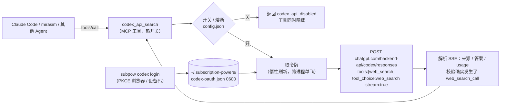

# 自建「Codex Responses 接口 + OAuth」搜索工具 —— 实施计划

> 2026-11-03。状态：**计划稿，尚未实现**。
> 目标：像 oh-my-pi 那样，不启动 `codex` CLI，而是自己完成 ChatGPT OAuth 登录，直接请求 `chatgpt.com/backend-api/codex/responses`，用 OpenAI 托管的 `web_search` 工具搜索，集成进我们的 MCP。
> 参考：`oh-my-pi-codex-websearch.zh.md`（它的做法）、`dot-direct-api-implementation-log.zh.md`（Dot 直连的经验）、`parallel-search-failure-analysis.zh.md`（现有 CLI 方案为什么慢）。

> **更新（2026-11-03）：方案 B 已实现并实测，见文末 §13。** 按你的决定：工具名用 `codex_api_search`；统一入口 `web_search` 已做；凭据暂用方案 B（只读借用 `~/.codex/auth.json`）；方案 A（自建 OAuth 登录）改为 TODO，见仓库根目录 `TODO.md`。下文 §4～§9 保留为方案 A 与总体设计的参考，与实现不一致之处以 §13 为准。

## 0. 结论

1. **能不能直接照搬？** 许可上可以，工程上不建议整份搬。
   - oh-my-pi 是 **MIT** 许可（版权方：Mario Zechner、Can Bölük、Stencil Labs），允许复制和修改，条件是保留版权声明和许可文本。我们的项目也是 MIT，没有冲突。
   - 但它的相关代码大约 1500 行，和一整套框架缠在一起：Bun 运行时、`@oh-my-pi/*` 工作区包、KDL 规则编译器、SQLite 凭据库、ModelRegistry。直接拷过来要么带上整个框架，要么到处改依赖。
   - **做法：移植而不是复制。** 把其中纯逻辑的部分（请求体、请求头、SSE 解析、来源提取、错误分类、JWT 解码）翻译成纯 Node ESM，保留署名；OAuth 登录和令牌存储按我们的需要重写，体量约 600 行，不增加任何 npm 依赖。
2. **相比现在的 CLI 方案，直接请求的好处很具体**：没有 `codex exec` 的冷启动；没有 Codex 代理会话自带的系统提示词、插件和 MCP 加载开销（实测 CLI 每次搜索输入约 4 万 token，而输出只有几百；其中固定开销占多少是推断，直连后的真实数字要在阶段 0 量）；`tool_choice` 强制搜索；来源是结构化字段，不用从文本里抠。
3. **凭据怎么存是最需要你拍板的一点**（§4）。我推荐：**自己登录一份独立的 OAuth 会话**，不去读 `~/.codex/auth.json`。
4. **风险性质和 Dot 一样**：用的是 Codex CLI 的 `client_id` 和私有接口，条款风险不会因为是 OAuth 就变小（§8）。所以同样做成**实验性、默认关闭、可随时开关、会自动熔断**。
5. 建议先做一个**很小的验证**（§9 阶段 0），再投入实现。

## 1. 它和现有两条路的关系

| | `codex_web_search`（CLI） | `dot_web_search`（Dot 直连） | **新：Codex 直连 API** |
|---|---|---|---|
| 接口 | 起 `codex exec` 子进程 | 网页 messaging 接口 | Responses 接口（Codex 官方客户端同款） |
| 身份 | `~/.codex` 里的登录 | 浏览器会话 Cookie | 自己做 OAuth，Bearer 令牌 |
| 强制搜索 | 靠提示词 | 靠提示词 | `tool_choice: web_search` |
| 来源 | 从答案文本里提取 | 从回复文本里提取 | 结构化：`action.sources` 加 `url_citation` |
| 单次耗时 | 15–60 s | 15–18 s | 预计 3–15 s（待测） |
| 额度 | 订阅（每次约 4 万 token 输入） | 称无限（未验证） | 订阅（输入明显更少） |
| 并发 | 同进程串行 | 全账号单房间，必须串行 | 请求彼此独立，可小并发 |
| 官方程度 | 官方 CLI | 私有接口 | 私有接口，但协议与官方 CLI 相同 |

最终希望形成一条兜底链：**Dot（若开）→ Codex 直连 API → CLI → 本机 searxng**，每一环都有独立开关。

## 2. 照搬还是移植：逐块决定

oh-my-pi 的相关文件及我们的处理：

| oh-my-pi 的位置 | 内容 | 行数 | 决定 |
|---|---|---|---|
| `coding-agent/src/web/search/providers/codex.ts` | 请求体、头、SSE 解析、来源提取、错误分类、凭据分支 | 683 | **移植约 70%**：删掉 ModelRegistry、AuthStorage、自定义端点分支、查询语法改写；保留请求体、SSE 状态机、来源去重、`utm_source=openai` 清理、错误码归类、“没搜索就报错”的校验、图片占位符过滤 |
| `catalog/src/wire/codex.ts` | 基础地址、头名常量、JWT 解码（账号 ID、区域） | 166 | **整块移植**（纯函数）。版本号改为运行时取（见 §6.3） |
| `ai/src/registry/oauth/openai-codex.ts` | 授权 URL、换令牌、设备码登录、JWT 身份解析 | 302 | **移植**：授权参数、设备码流程、身份解析 |
| `ai/src/registry/oauth/callback-server.ts` | 本地回调服务 | 690 | **重写成约 80 行**：只服务一个固定回调，不要它的端口回退、多协议、手动粘贴等 |
| `ai/src/registry/oauth/pkce.ts` | PKCE | 18 | 用 Node 的 `crypto` 重写，几行 |
| `ai/src/registry/engine/refresh.ts`、`auth-retry.ts` | 刷新、401 后重试、多账号轮换 | 109 加 503 | **只取“401 后强制刷新一次再重试”**；多账号轮换不要 |
| `catalog/.../auth/openai-codex.kdl` | 登录和刷新的声明（client_id、scope、参数） | 34 | 当作**参数来源**，写成常量 |
| `utils/src/stream.ts` 的 `readSseJson` | SSE 读取 | 643（取一小段） | 用 `fetch` 的流自己写 40 行 |
| `scripts/check-spoofed-versions.ts` | 版本漂移检查 | — | 不移植，但借鉴思路（§6.3） |

署名要求：新增 `NOTICE` 或 `THIRD_PARTY_NOTICES.md`，放 MIT 许可全文和上述三行版权；移植的文件顶部加一行 `Adapted from can1357/oh-my-pi (MIT)` 并注明来源文件。

**另一条路（不建议）**：直接安装 oh-my-pi，让 MCP 调用它的 `omp q "…"`。省去自己维护私有协议，但要引入 Bun、一整个 Agent 和它自己的登录，每次调用的开销和复杂度反而更高。

## 3. 总体架构



新增文件（全部在 `server/` 下，纯 Node ESM，无新依赖）：

| 文件 | 内容 | 预计行数 |
|---|---|---|
| `lib/codex-wire.mjs` | 常量、头名、JWT 解码、URL 规整、版本号解析 | 80 |
| `lib/codex-oauth.mjs` | PKCE、授权 URL、回调服务、设备码、换令牌、刷新、存储 | 250 |
| `lib/codex-api.mjs` | 请求构造、SSE 解析、来源提取、错误分类、重试、熔断、搜索入口 | 300 |
| `lib/lock.mjs` | 从 `dot.mjs` 里抽出的跨进程锁，Dot 和刷新共用 | 40 |
| `bin/subpow.mjs` | 新增 `codex login / logout / status / on / off / reset / check / search` | +80 |
| `index.mjs` | 注册 `codex_api_search`，沿用热开关 | +30 |
| `tests/codex-api.test.mjs` | 用假的 `fetch` 和 SSE 固定样例测试，不联网 | 250 |

## 4. 凭据策略（需要你决定）

OAuth 刷新令牌的行为决定了怎么存。oh-my-pi 的刷新代码注释写着“没有被轮换的刷新令牌会保留”，说明服务端有时返回新刷新令牌、有时不返回；它在多进程场景下用 SQLite 记录“有没有别人先轮换过”。**OpenAI 的刷新令牌是不是单次有效，我没有验证**，设计按最坏情况考虑。

| 方案 | 做法 | 优点 | 风险 |
|---|---|---|---|
| **A. 自己登录一份独立会话（推荐）** | `subpow codex login` 完成一次 PKCE 登录，令牌存 `~/.subscription-powers/codex-oauth.json`（0600） | 与 Codex CLI 互不影响：我们刷新不会让它掉线，它刷新也不会让我们掉线；和 oh-my-pi 行为一致；符合你说的“凭据存在用户目录隐藏文件夹” | 要登录一次；固定回调端口 `1455` 被占用时失败，可改用设备码登录 |
| B. 只读借用 `~/.codex/auth.json` | 每次调用时读它的 `access_token`，**从不刷新** | 不用登录，可立即验证 | 令牌过期要等 Codex CLI 自己刷新；读取别的程序的凭据；如果日后改成我们刷新，会和 CLI 抢轮换 |
| C. 环境变量 `OPENAI_CODEX_OAUTH_TOKEN` | 手动提供一个令牌 | 最简单，oh-my-pi 也支持 | 不会续期，只适合临时测试 |

**建议**：正式实现用 A；阶段 0 的验证用 B（只读、一次、不刷新），需要你同意。

刷新必须**跨进程单飞**：每个会话都有自己的 MCP 进程，如果几个进程同时发现令牌快过期、同时去刷新，可能互相作废对方拿到的刷新令牌。做法：刷新前拿文件锁；拿到锁后**先重新读一遍文件**，如果别的进程已经刷新过就直接用，不要再刷新（这一点参考了 oh-my-pi 的“peer rotated the row”检查）。令牌文件必须原子写。

## 5. 请求与响应（来自 oh-my-pi，需实测确认）

**地址**：`https://chatgpt.com/backend-api/codex/responses`

**头**（移植自 `buildCodexHeaders`）：

| 头 | 值 |
|---|---|
| `Authorization` | `Bearer <access_token>` |
| `chatgpt-account-id` | JWT 里的 `chatgpt_account_id`（决定从哪个订阅扣额度） |
| `x-openai-internal-codex-residency` | 仅当令牌里声明了区域时发送，否则企业区域锁定的账号会 401 |
| `OpenAI-Beta` | `responses=experimental` |
| `originator` | 我们自己的标识（见 §8） |
| `version` | Codex 客户端版本（见 §6.3） |
| `Accept` / `Content-Type` | `text/event-stream` / `application/json` |

**体**：

```jsonc
{
  "model": "gpt-6-luna",
  "stream": true,
  "store": false,
  "include": ["web_search_call.action.sources"],
  "parallel_tool_calls": true,
  "instructions": "<系统提示：只搜索并如实引用>",
  "input": [{"type":"message","role":"user","content":[{"type":"input_text","text":"<查询>"}]}],
  "tools": [{"type":"web_search","search_context_size":"medium|high"}],
  "tool_choice": {"type":"web_search"}
}
```

oh-my-pi 的文档里还提到：Codex 后端会拒绝采样参数（`temperature` 之类），回 400，所以不要发。

**解析**（移植自 `callCodexSearch`）：

- `response.web_search_call.*` → 标记确实搜索过；没出现就报错，**不把凭记忆写的回答当搜索结果**；
- `response.output_item.done` 的 `web_search_call` → 从 `action.sources` / `sources` / `results` 收集来源；
- `message` 的 `output_text` → 答案；`annotations` 里的 `url_citation` → 来源加 snippet；
- `response.completed` → usage（输入 token 要扣除缓存部分）；
- `error` / `response.failed` → 兼容三种错误包装，按文本归类 429 / 401 / 403 / 504 / 500；
- 清理：去掉 `utm_source=openai`；URL 去重；没有注解时从文本里提取链接；纯“见附图”之类的占位答案视为失败。

## 6. 工具设计

### 6.1 `codex_api_search`

沿用 `codex_web_search` 的参数形状，调用方可以平滑切换：

| 参数 | 说明 |
|---|---|
| `query` | 查询 |
| `mode` | `quick`（默认）：一次请求，主要返回结构化来源；`deep`：更高的 `search_context_size` 和更强的模型，写综合回答 |
| `max_results` | quick 默认 10，deep 默认 5 |
| `recency` | 放进提示词里引导 |
| `timeout_ms` | 默认 60 s |

返回结构与现有工具一致，并增加 `backend: "codex_api"`、`request_id`、`usage`、`queued_ms`、`elapsed_ms`，每次调用写入同一份 `calls.jsonl`。

**quick 模式的结果从哪来**：来源（标题、URL）直接取 `web_search_call` 事件里的结构化字段，不依赖模型怎么写；一句话摘要取 `url_citation` 的 snippet，不够的再让模型补。能不能用 `text.format` 强制 JSON 输出，**不确定**，列入验证项。

**模型和推理强度**：按你之前的选择，quick 用 `gpt-6-luna` 加较低推理强度，deep 用 `gpt-6.1-sol` 加 `medium`。模型 ID 来自本机 `~/.codex/models_cache.json` 的列表；推理强度参数在 ChatGPT 后端怎么传，**需要验证**。

### 6.2 命令行

```
subpow codex login [--device]        # 登录；默认浏览器 PKCE（本机 1455 端口），--device 为设备码
subpow codex logout                  # 删除本地令牌
subpow codex status                  # 开关、熔断、账号邮箱、套餐、令牌与刷新到期、最近成功率
subpow codex on | off | reset        # 开 / 关 / 清除熔断（on 前先健康检查）
subpow codex check                   # 健康检查：刷新令牌并发一个最小请求
subpow codex search "<q>" [--mode deep]   # 直接跑一次
```

### 6.3 客户端版本号：不要写死

oh-my-pi 写死 `0.159.0`，并专门有个脚本跟随 npm 上的最新版，因为后端会按这个版本决定哪些模型可见，太旧会看不到新模型。我们**本机已装 `codex`（现为 0.163.0）**，可以运行时执行 `codex --version` 取值并缓存，取不到才用写死的后备值。这样不用单独维护漂移检测脚本。

## 7. 开关与熔断（复用 Dot 的那套）

`~/.subscription-powers/config.json` 增加 `codex_api` 块：`enabled`（默认 `false`）、`tripped`、`tripped_reason`、`consecutive_failures`、`trip_after`、`concurrency`（默认 2）、`min_interval_ms`、`timeout_ms`。热开关、命令行、自动隐藏工具的机制与 Dot 完全相同，已经实测过。

**触发熔断（连续 3 次）的情形**：刷新令牌失败（`invalid_grant`、已被撤销）、401 且强制刷新后仍 401、403（含区域或套餐不允许）、被 Cloudflare 挑战。**不计入**：网络超时、5xx、429、模型暂时不可用。

**套餐变化即熔断**（上次文档里的 P1 建议，这次一并做）：每次拿到令牌就解码 `chatgpt_plan_type`，与登录时记录的值比较，变了（如 `pro` 变成 `plus`）立即写入 `tripped_reason: plan_changed` 并关闭，不等失败累积。

**重试**（借鉴 oh-my-pi）：网络错误和 5xx 退避重试最多 2 次；429 读 `Retry-After`，在 2 分钟预算内重试；401 强制刷新后重放一次。

## 8. 风险（需要你确认）

1. **服务条款与账号风险。** 用 Codex CLI 的 `client_id` 做 OAuth，并向私有接口发请求，属于“非官方客户端使用订阅额度”。oh-my-pi 公开这么做并在请求头里如实标注 `originator: omp`，但这不等于 OpenAI 认可。后果可能是限流、要求重新验证，严重时账号受限，而这是你的**主 ChatGPT 账号**，不只影响搜索工具。我们之前否决“路径 C”就是出于这个原因，这次是你明确要求走它，所以：默认关闭、实验性、熔断、不批量、不自动处理验证。
2. **`originator` 取什么值。** 如实写我们自己的标识（例如 `subscription-powers`），不冒充 `codex_cli_rs`。但服务端是否接受任意 `originator` **没有验证**；oh-my-pi 用 `omp` 能通，不代表任意值都能通。验证项。
3. **`client_id` 与回调地址。** 登录用的是 Codex CLI 的公开 `client_id`，OpenAI 只放行 `http://localhost:1455/auth/callback`。**端口被占用就无法登录**（比如 Codex 桌面应用正在登录时），要用设备码登录。授权页面会显示这是“Codex”，请你知情。
4. **接口无承诺。** 字段、头、版本门槛随时会变。出问题的表现应该是熔断关闭，不是静默返回错误结果。
5. **额度。** 这是 Codex 的订阅额度（5 小时和 7 天窗口），和 CLI 方案共用，不是无限。并发要克制。每次消耗比 CLI 少，但不是零。
6. **凭据文件等同于账号登录态。** 0600、目录 0700，不进 git，`.gitignore` 里要加上，也不写进日志。

## 9. 分阶段实施

| 阶段 | 内容 | 产出与验收 | 需要你确认 |
|---|---|---|---|
| **0. 验证（约半小时）** | 只读取 `~/.codex/auth.json` 的 `access_token`（**不刷新、不写回、不打印**），向 Responses 接口发**一个**最小搜索请求 | 确认：地址和头可用；`gpt-6-luna` 能搜索；`tool_choice` 生效；`include` 返回来源；`reasoning` 参数怎么传；任意 `originator` 是否被接受；单次耗时与 token 用量 | **需要**：这会使用你的 Codex 凭据并消耗一次订阅额度 |
| 1. 登录与存储 | PKCE 浏览器登录、设备码、换令牌、JWT 解析、原子存储、单飞刷新、`subpow codex login/logout/status` | 独立登录成功；并发刷新不丢令牌（假服务器测试）；确认刷新令牌是否轮换 | 一次真实登录（弹浏览器授权） |
| 2. 搜索客户端与工具 | 请求构造、SSE 解析、来源清理、错误分类、重试、`codex_api_search` | 单元测试（假 `fetch`）；quick 和 deep 各一次真实搜索；并发 2 个 | 少量额度 |
| 3. 开关与熔断 | `codex_api` 配置块、热开关、套餐变化检测、`on` 前健康检查 | 与 Dot 同级别的实测：开关热生效、模拟 401 触发熔断 | — |
| 4. 文档与署名 | README 标注实验性；`THIRD_PARTY_NOTICES.md`；写实施记录 | — | — |
| 5. 统一入口（可选） | 一个 `web_search` 工具，按 Dot → Codex API → CLI 的顺序尝试，自动跳过被关闭或熔断的环节，返回里注明用了哪一环 | 单个后端挂掉时调用方无感 | 是否要做 |

阶段 0 如果发现接口不可用（比如 `originator` 被拒、模型不可见、必须带额外校验），就在投入实现之前止步，成本只有一次请求。

## 10. 测试方案

- **单元测试**（不联网）：JWT 解码（账号 ID、区域、套餐）；URL 清理；来源去重与合并；SSE 事件序列用固定样例（含 oh-my-pi 测试里的最小样例）；“没有 `web_search_call` 就报错”；三种错误包装；刷新后重放；单飞刷新（两个并发调用只触发一次刷新）；原子写与 0600 权限；套餐变化触发熔断。
- **集成测试**（假服务器）：本地起一个 HTTP 服务，模拟 `/oauth/token`、`/codex/responses` 的 SSE，包括 401、429（带 `Retry-After`）、响应中途断开。
- **真实测试**（手动，消耗额度）：登录、quick、deep、并发 2、关闭后工具隐藏。

## 11. 待验证事项

- 自己的 OAuth 登录能否用 Codex 的 `client_id` 在非官方客户端完成（oh-my-pi 能，但我们没试过）。
- 刷新令牌是否轮换；服务端是否限制同一账号的会话数量。
- 任意 `originator` 值是否被接受。
- 推理强度参数、`text.format` 结构化输出是否被 ChatGPT 后端支持。
- 令牌里的 `chatgpt_plan_type` 在 Codex 令牌和网页令牌里是否一致（网页那份是 `prolite`）。
- quick 模式实际耗时与 token 用量，是否真的比 CLI 小一个量级。
- 搜索请求是否计入 `wham/usage` 的额度窗口，以及计多少。

## 12. 需要你决定的事

1. 凭据策略选 **A（独立登录）** 吗？阶段 0 是否同意**只读一次** `~/.codex/auth.json` 的访问令牌来验证？
2. 工具名用 `codex_api_search`，还是直接并入现有的 `codex_web_search`，加一个 `transport: "api" | "cli"` 参数？我倾向前者：风险和开关各自独立，出问题互不影响。
3. 是否接受 §8 的风险，做成实验性、默认关闭？
4. 是否要做阶段 5 的统一入口？

## 13. 实施结果（2026-11-03）

### 13.1 阶段 0 验证（只读借用令牌，共 5 个请求）

| 验证项 | 结果 |
|---|---|
| 令牌可用、Cloudflare 不拦 | 通过。HTTP 200；套餐 `prolite`；令牌剩余约 9 天 |
| 自定义 `originator: subscription-powers` | **被接受**（计划里的待验证项） |
| `version` 头 | 取本机 `codex --version`（验证时 0.166.0；会话开始时是 0.163.0，说明 Codex 自己在更新，写死确实会过期） |
| `gpt-6-luna` + `reasoning.effort: low` | 通过，6.3 秒，输入 8,738 token |
| `gpt-6.1-sol` + `medium` | 通过，14.6 秒，25 个来源 |
| 强制搜索 | 生效；事件序列里有 `response.web_search_call.searching/completed` |
| 来源字段 | `action.sources` 条目**只有 `type` 和 `url`，没有标题**；带标题的是答案里的 `url_citation` 注解 |
| `text.format` 的 `json_schema`（strict） | **支持**，所以 quick 档位让模型按 schema 直接返回 `{title, url, summary}` |
| 用量 | 输入 8.7K～13K token，输出 100～435 token；CLI 同类搜索输入 4.1 万～4.7 万 |

### 13.2 已实现

| 文件 | 内容 |
|---|---|
| `server/lib/codex-wire.mjs` | 常量、JWT 解码（账号 / 套餐 / 驻留区）、请求头、版本号运行时获取、SSE 错误归类（移植自 oh-my-pi） |
| `server/lib/codex-auth.mjs` | 方案 B：只读读取 `~/.codex/auth.json`；过期不续期，直接报 `codex_api_token_expired` |
| `server/lib/codex-api.mjs` | 请求体构造、SSE 状态机、来源清理、重试、并发上限、熔断、套餐 / 账号绑定、`webSearch()`（移植自 oh-my-pi） |
| `server/lib/search.mjs` | 统一入口 `web_search`：按顺序尝试后端，跳过未开启的，失败则换下一个 |
| `server/lib/links.mjs` | 从 `dot.mjs` 抽出的链接清洗，两个后端共用 |
| `server/lib/store.mjs` | 开关存储泛化为每个后端一个配置块；搜索顺序配置 |
| `server/bin/subpow.mjs` | 新增 `codex status/on/off/reset/check/login/search`、`search status/order/run` |
| `server/index.mjs` | 注册 `codex_api_search`（热开关）与 `web_search` |
| `server/tests/codex-api.test.mjs` | 27 个测试（假 `fetch` + 固定 SSE，不联网）；全套 `npm test` 共 37 个 |
| `THIRD_PARTY_NOTICES.md` | oh-my-pi 的 MIT 署名与许可全文 |
| `TODO.md` | 方案 A 与其它待办 |

### 13.3 与计划的差异

| 计划 | 实际 |
|---|---|
| 凭据方案 A（独立登录）+ 跨进程单飞刷新 | 先做方案 B（只读借用）。因为从不刷新，**不需要锁**，`lock.mjs` 没有抽取；`codex login` 只是 TODO 提示 |
| 阶段 5 统一入口为可选 | 已做。默认顺序 Dot → `codex_api` → CLI，可用 `subpow search order` 改，也可每次调用传 `backends` |
| quick 的结果从工具事件的来源取标题 | 实测来源**没有标题**，改为用 `json_schema` 让模型返回标题和摘要；其余被检索到但未描述的 URL 放进 `other_sources` |
| 版本号写死或定期检查 | 运行时执行 `codex --version`，失败才用后备值 |
| 套餐变化即熔断 | 已做，但对象是**开启时记录的套餐 / 账号**：`subpow codex on` 记录，之后令牌里的值变了立即熔断 |

### 13.4 实测结果（真实 MCP 客户端）

| 项目 | 结果 |
|---|---|
| quick | 约 9～18 秒（直接用 `subpow` 跑一次 17.8 秒，MCP 里 8.7～13.4 秒），输入约 9K token，返回 5～10 条加最多 20 个其他来源 |
| deep | 20.5 秒，`gpt-6.1-sol`，输入 16.6K，4 个来源、2 条引用，答案里的 `utm_source=openai` 已去除 |
| 热开关 | `codex off` 后工具约 3 秒内消失（收到 1 次 `list_changed`），`on` 后恢复，不重连 |
| 统一入口兜底 | `codex_api` 关闭时被跳过，自动落到 CLI，返回 `skipped` 与 `attempts`；CLI 同样的 quick 搜索输入 46,619 token，约为直连的 5 倍 |
| 并发 | 3 个请求、上限 2：第三个排队 8.7 秒，总耗时 16.7 秒（串行约 34 秒） |
| 只读保证 | 测试前后 `~/.codex/auth.json` 的 SHA-256 与修改时间完全一致；另有单元测试，并做了变异检验（故意让读取函数写文件，测试立刻失败） |
| 机密扫描 | 仓库里没有令牌或形似 JWT 的字符串（只有文档里提到的 Cookie 名字） |

### 13.5 仍未验证 / 已知局限

- **Pro 到期后的真实表现**：只是推断。
- **令牌过期**：方案 B 不续期。Codex 久不使用（CLI 和桌面应用都不用）时令牌会过期；此时直连返回 `codex_api_token_expired`，统一入口兜底到 CLI。"CLI 运行会顺带刷新该文件"是我的推断，没有专门验证。
- **quick 的摘要来自模型**，不是网页原文，可能不准确；`other_sources` 没有标题。
- **用的是主 ChatGPT 账号的 Codex 额度**（5 小时和 7 天窗口），不是无限；是否计入 `wham/usage` 没有核实。
- **条款风险**：见 §8，没有变化。README 里"不读凭据、不直连后端"的声明已经改成"默认模式如此，两个实验性后端例外"。
- 统一入口默认的第一环是 Dot；这次没有用默认顺序做真实调用，以免再向你的 Dot 对话里发消息。Dot 后端本身和统一入口的顺序逻辑都分别测过（前者实测，后者用假后端的单元测试）。

### 13.6 命令速查

```
node server/bin/subpow.mjs codex status                 # 开关、熔断、绑定的套餐 / 账号、令牌到期、最近调用
node server/bin/subpow.mjs codex on [--live] | off | reset
node server/bin/subpow.mjs codex check [--live]         # 不加 --live 只读令牌，不发请求、不耗额度
node server/bin/subpow.mjs codex search "问题" [--mode deep] [--model M] [--effort E]
node server/bin/subpow.mjs search status | order dot,codex_api,codex_cli | run "问题" [--backends codex_api]
cd server && npm test                                   # 37 个测试
```
