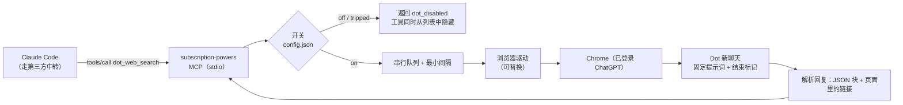

# 用 ChatGPT Pro 的 Dot 做 Web Search MCP —— 方案设计

> 2026-11-03。状态：**设计稿，尚未实现**。
> 目标场景：Claude Code 接了第三方中转站，内置 WebSearch 不可用 → 需要一个 Web Search MCP，后端用 ChatGPT Pro 的 Dot（用户称额度不限）。
> 额外要求：将来不续费 Pro，Dot 会失效 → 必须有**可随时开关**的机制。
> 参考：`docs/oh-my-pi-codex-websearch.zh.md`（oh-my-pi 如何走 Codex 订阅搜索）。

> **更新（2026-11-03）：「直接调接口」已实测跑通并实现，见文末 §11。** 下文 §2、§4 中“没有已知接口 / 需要浏览器”的判断已被实测修正；浏览器方案（专用 Chrome、复用 bridge）暂缓。另有几处假设已被推翻，**不要照着实现**：§5.1 的 `chat_strategy: new`、§6.2 和 §7 第 3 步的“每次新开聊天”（账号只有一个 Dot 房间，无法新开）。完整过程、困难与修正见 `docs/dot-direct-api-implementation-log.zh.md`。

## 0. 结论

1. **chrome-agent-bridge 能连上你的 Chrome，Dot 标签页也能读到**（见 §1）。
2. 与 oh-my-pi 的做法**不一样**：Codex 搜索有 Responses API（带 `tool_choice` 强制搜索），而 **Dot 是一个常驻的个人代理产品，没有已知的公开接口**。能做的是**驱动网页界面**（向输入框发消息、读回复），或者逆向它的私有后端接口。后者就是我们之前否决的"路径 C"，这里**不推荐**。
3. 推荐做法：在现有 `subscription-powers` 里新增 `dot_web_search`，后端做成可替换的"浏览器驱动"，**默认关闭**，由一份本地配置文件控制开关；开关**热生效**，不用重启会话（§5）。
4. 三个必须你先拍板的风险：**服务条款**、**Dot 会异步干活并有副作用**、**"额度无限"没有验证**（§6）。

## 1. 本次实际核实到的事实

只做了只读操作：没有发送消息，没有点击，没有抓网络请求。

| 项目 | 结果 |
|---|---|
| chrome-agent-bridge | 已连接，扩展 v0.11.0，1 个 Chrome 实例，8 个标签页 |
| Dot 标签页 | 能找到并读取，标题是 Dot 的名字，URL 形如 `https://chatgpt.com/dots/<dot-id>~<hash>` |
| 页面结构 | 左侧栏：首页 / 资料空间 / 定时任务 / 插件 / 探索 / 站点；聊天列表里有置顶、项目、最近；主区域有「消息」输入框、「听写」和「发送」按钮（输入为空时「发送」是禁用状态）；右侧有「呼叫」「Slack」「xx 的电脑（当前离线）」「近期活动」「输出内容」 |
| Dot 的行为 | 从页面里已有的一次调研请求可以看到：它会**分阶段**发进度消息（"我会查阅…""已经找到…""报告做好了"），最后给出一个 `.md` 附件。也就是说它**会联网研究**，但**回复不是一次性的** |
| 本机桥接 | 有一个 native host 进程监听 `127.0.0.1` 的一个端口；本机还装着 searxng、open-websearch 等 MCP |

**没有核实的**（需要在 §8 的 spike 里验证）：

- Dot 网页用的后端接口地址和协议（需要抓网络请求，会涉及请求头里的登录凭据，要你同意）；
- "额度无限"（这是你的说法，我没法从页面确认）；
- Dot 能不能被约束成"只搜索、只按固定格式回答、不碰它自己的电脑和记忆"；
- 能不能新建多个 Dot，或者新开聊天时不影响记忆。

## 2. 为什么不能照搬 oh-my-pi

| | oh-my-pi + Codex | Dot |
|---|---|---|
| 接口 | `POST chatgpt.com/backend-api/codex/responses`，Responses 协议，相当于 Codex CLI 的接口 | 没有已知公开接口，网页使用的是它自己的后端 |
| 强制搜索 | `tool_choice: {type:"web_search"}`，协议层保证 | 只能靠提示词 |
| 结果结构 | SSE 事件里有 `web_search_call` 和 `url_citation` 注解 | 只有渲染后的网页文本和链接 |
| 凭据 | OAuth（复用 Codex CLI 的 client_id） | 网页登录态 |
| 生命周期 | 一次请求，一次响应 | 代理式：可能分多条消息、花几分钟、中途改变计划 |

所以 Dot 更像"让一个人帮你查"，而不是"调一个搜索函数"。设计上要**把不确定性包起来**。

## 3. 总体架构



## 4. 怎么触达 Dot 所在的 Chrome（三种驱动）

| 驱动 | 做法 | 优点 | 缺点 |
|---|---|---|---|
| **A. 专用 Chrome 实例 + CDP**（推荐） | 用独立的 `--user-data-dir` 启动一个真实 Chrome，加 `--remote-debugging-port`，登录一次 ChatGPT；MCP 用 playwright-core 的 `connectOverCDP` 连接 | 自成体系，不依赖第三方扩展；不抢你日常浏览器的焦点；登录态独立 | 要多开一个 Chrome 窗口（最好不要无头，否则更容易被反自动化拦截）；要单独登录一次；Chrome 136 以后默认配置目录不允许远程调试，所以必须用独立目录 |
| B. 复用 chrome-agent-bridge | MCP 通过它本机的 native host 通道，驱动你日常 Chrome 里的标签页 | 不用另外登录，复用现有登录态 | 那个通道是第三方工具的内部协议，没有承诺稳定；会在你正在用的浏览器里操作标签页；要先读它的源码确认有没有可用的客户端接口 |
| C. 逆向私有后端接口 | 从网页的网络请求里找出接口，带 token 直接调 | 快，没有浏览器依赖 | 私有接口、凭据要自己持有、随时失效，风险最高。**不推荐** |

推荐 **A** 作为正式实现，**B** 只当 spike 阶段的快速验证手段。驱动层写成接口（`send(prompt) → 最终回复`），以后换实现不动上层。

### 4.1 几个名词和疑问

**"专用 Chrome"是什么？** 不是无头浏览器，也不是 Playwright 自带的浏览器。就是**另外再开一个真实的 Google Chrome 进程**，用一个单独的资料目录，和你日常用的 Chrome 完全隔离：

```
open -na "Google Chrome" --args \
  --user-data-dir=$HOME/.cache/subscription-powers/dot-profile \
  --remote-debugging-port=9333
```

- 第一次在这个窗口里手动登录 ChatGPT，登录态保存在那个目录里，以后不用再登。
- 窗口是**有界面**的，可以最小化或放到别的桌面。默认不用无头模式，因为无头更容易被网站识别为自动化；登录稳定后可以再试 `--headless=new`。
- 需要单独的资料目录，是因为 Chrome 136 起，默认资料目录会忽略 `--remote-debugging-port`。
- 代价：多一个 Chrome 进程，常驻内存大约几百 MB，空闲时几乎不占 CPU。那个资料目录里存着 ChatGPT 的登录态，等同于凭据，要按凭据对待。

**用 Playwright 吗？** Playwright 只是连接 Chrome 的客户端库，不是必需的。我会用 `playwright-core` 的 `chromium.connectOverCDP('http://127.0.0.1:9333')`：它不下载自带浏览器，只连接上面那个真实 Chrome。也可以用 `puppeteer-core`，或者直接用 WebSocket 讲 CDP 协议，效果一样。

**能不能直接调接口，不要 Chrome？** 技术上可能，但有三个问题：

1. **接口没有文档。** 要从网页的网络请求里逆向出来，而 Dot 的接口我还没有看过，不知道长什么样。
2. **ChatGPT 网页的请求通常不只是一个 token。** 据我对 ChatGPT 网页版的了解，聊天请求常常还带 Cloudflare 的通行 cookie（和浏览器指纹、UA 绑定）以及页面脚本现场算出来的校验令牌。这些我没有在 Dot 上核实，但如果也是这样，脱离浏览器自己算很容易失效。浏览器在这里的作用，就是让真实的页面脚本帮我们完成这些事。
3. **凭据要自己持有。** 直接调接口要把登录令牌取出来存到别处，等于项目要保管你的 ChatGPT 凭据，这和本项目"不碰凭据"的定位相反；用浏览器则凭据始终留在 Chrome 的资料目录里。

直接调接口的好处是快，也不用开浏览器。**服务条款风险两种方式一样**，不会因为不开浏览器就变小。如果你想评估这条路，spike 阶段可以抓一次网络请求，只看接口地址、请求头里有哪些校验字段、事件流格式，凭据全部打码，抓之前先问你。

**为什么不直接用你日常的 Chrome（方案 B）？** 可以，而且最省事：不用新开窗口，不用再登录。不选它作正式方案，是因为 chrome-agent-bridge 的内部通道不是公开接口，没有稳定性承诺；还要求你的日常 Chrome 一直开着，并且我们的程序会在你正在使用的浏览器里操作标签页。如果你更看重省事，可以先用 B 做原型。

## 5. 开关设计（核心需求）

你的要求："将来可能叫你关掉或开启"。设计成**四层**，从人工到自动：

### 5.1 一份配置文件，热读取

位置：`~/.config/subscription-powers/config.json`（放在仓库之外，Dot 的 URL 和登录目录是账号相关的，不进 git）。

```jsonc
{
  "dot": {
    "enabled": false,                 // 总开关，默认关闭
    "state": "off",                   // off | on | tripped（被自动熔断）
    "tripped_reason": null,
    "driver": "cdp",                  // cdp | bridge
    "chat_url": "https://chatgpt.com/dots/<dot-id>",
    "cdp_url": "http://127.0.0.1:9333",
    "user_data_dir": "~/.cache/subscription-powers/dot-profile",
    "chat_strategy": "new",           // new（每次新开聊天）| reuse
    "max_concurrency": 1,
    "min_interval_ms": 3000,
    "timeout_ms": 240000
  }
}
```

### 5.2 热生效：不用重启会话

之前改代码后，运行中的 MCP 进程要等会话重开才更新，这次不能再这样。做法：

- 进程内监听这份文件（`fs.watch` 加每次调用前再读一次兜底）。
- 工具注册后保留 `registeredTool`，开关变化时调用 `.enable()` / `.disable()`。已核实：本仓库用的 MCP SDK 1.30.0 提供这两个方法，并且会自动发送 `notifications/tools/list_changed`。
- 支持 `list_changed` 的客户端（Claude Code 支持）会**立即把工具从列表里去掉或加回来**。不支持的客户端，调用时处理函数里还有第二道保险：关闭状态直接返回 `{ok:false, code:"dot_disabled", message:"...已关闭，请改用 codex_web_search"}`，**不会碰浏览器**。

### 5.3 自动熔断：Pro 到期时不会反复冲撞

连续 N 次（默认 3）被判定为"Dot 不可用"（和网络抖动区分开）时，自动把 `state` 改成 `tripped`、写入原因、并关掉工具。判定为"不可用"的信号：

- 页面跳到登录页，或出现升级 Pro 的提示；
- Dot 页面打不开（404、无权限）；
- 找不到「消息」输入框或「发送」按钮（界面改版）。

网络超时、CDP 连不上不算，这些只返回错误让调用方重试。

### 5.4 一行命令

提供 `server/bin/subpow.mjs`：

```
node server/bin/subpow.mjs dot status    # 当前开关、熔断原因、最近 10 次调用的成功率
node server/bin/subpow.mjs dot on        # 开启（会先做一次健康检查，失败则拒绝开启并说明原因）
node server/bin/subpow.mjs dot off       # 关闭
node server/bin/subpow.mjs dot reset     # 清除熔断状态
```

你说一句"把 Dot 关掉"，我就执行 `dot off`；"再打开"就执行 `dot on`。`on` 不会盲目开启：先检查 Chrome 能连、登录态有效、输入框存在。

### 5.5 顺手统一已有的开关

现在 Claude 工具的开关是环境变量 `SUBPOW_ENABLE_CLAUDE`，改了要重启。可以一并挪到同一份配置里，同样热生效。这是顺带的，可以放到第二阶段。

## 6. 风险（需要你先看一眼）

### 6.1 服务条款

OpenAI 的使用条款里有一条，禁止在 API 之外用自动化或程序化的方式从服务中提取内容。**驱动网页界面正好落在这一条上**，更不用说逆向接口。请以你当前看到的条款为准。后果可能是限流、要求验证，严重时账号被限制。你的 Pro 账号上还有别的东西，这不是只赔一个搜索工具的事。

减轻办法：默认关闭；串行加最小间隔；不批量；每次调用日志留痕；出现验证码或异常提示立刻熔断，**不自动处理验证码**。降低不了风险，只是不把风险放大。

另外要说明：这和本项目 README 里"只起官方 CLI、不碰凭据"的定位不同。建议在 README 里把这个功能标成**实验性、默认关闭**。

### 6.2 Dot 是会自己行动的代理

从页面看，Dot 有自己的电脑、插件、Slack、定时任务和记忆。往里发搜索请求可能：

- 被它当成要办的事，开始用电脑、发 Slack、建任务；
- 进它的记忆，影响它以后的行为；
- 让聊天列表里堆满搜索记录。

对策：每次新开聊天（`chat_strategy: new`）；提示词里明确"只做网页搜索，不要使用电脑、插件、Slack，不要写入记忆，不要创建任务，不要追问"；spike 阶段验证这些约束有效。如果 Pro 允许再建一个专门的 Dot（比如叫"搜索"），把搜索放到那里，不要用你日常的那个。

### 6.3 额度无限没有验证

"无限"通常带有滥用防护，Dot 也可能有单独的限制。以日志里记录的成功率为准，不要假设它永远不限。

### 6.4 回复不是一次性的

Dot 会先发进度消息，再发最终结果。所以不能"发完就读第一条回复"。

## 7. 一次调用的流程

1. 读配置；`enabled` 不是 `on` 就返回 `dot_disabled`。
2. 进入串行队列（`max_concurrency`、`min_interval_ms`）。
3. 驱动层连上 Chrome，打开 Dot 的新聊天。
4. 发送固定模板提示词，里面带一个随机的**结束标记** `<<DONE:{nonce}>>`：
   - 只用网页搜索，最多 N 次；
   - 不使用电脑、插件、Slack，不写记忆，不创建任务，不提问；
   - 按 JSON 输出 `results: [{title, url, summary}]`（quick）或 `answer` 加 `sources`（deep）；
   - 最后一行输出结束标记。
5. 轮询**助手消息**节点：出现带 nonce 的结束标记，并且「发送」按钮恢复可用、文本稳定若干秒，才算完成。提示词本身（用户消息）里也有 nonce，所以只在助手消息里匹配。
6. 解析：取最后一个 JSON 代码块；来源链接**优先取页面里真实的链接元素的 href**，不是模型写的文字，并去掉 `utm_source=chatgpt.com` 这类跟踪参数。
7. 返回和现有工具同样的结构：`{ ok, mode, backend:"dot", results | answer+sources, queued_ms, elapsed_ms }`，同时写 `~/.cache/subscription-powers/calls.jsonl`。
8. （可选）清理：`cleanup: true` 时归档或删除这次聊天。默认不做，因为自动删除比保留更危险。

失败分类：`dot_disabled`、`dot_unavailable`（计入熔断）、`dot_timeout`、`dot_bad_output`（没找到 JSON，退而求其次只取链接并带警告）、`chrome_unreachable`。

## 8. 分阶段落地

| 阶段 | 内容 | 需要你确认 |
|---|---|---|
| **0. Spike（约半天）** | ① 读 chrome-agent-bridge 源码，确认有没有可用的客户端接口；② 在 Dot 里**手动发一条**搜索测试消息，验证：约束提示词是否生效、回复分几条、最终标记能否稳定出现、链接怎么在 DOM 里表示、发完「发送」按钮的状态变化；③ （可选）抓一次网络请求，只看接口地址和事件类型，凭据一律打码 | 会发一条真实消息、消耗一点 Dot 额度、留下一条聊天记录；抓网络请求会经过登录凭据，需要你明确同意 |
| 1. 开关与配置 | `config.json` 读取、热开关、`subpow dot on/off/status/reset`、熔断；先不接浏览器，用假驱动跑通 | — |
| 2. 驱动与工具 | CDP 驱动、`dot_web_search`（quick / deep）、日志、冒烟测试 | 专用 Chrome 窗口和一次登录 |
| 3. 兜底链（可选） | 统一的 `web_search` 入口：Dot → `codex_web_search` quick → 本机已有的 searxng，自动跳过被关闭的后端 | — |
| 4. 文档 | README 标注实验性；写明到期后如何关闭 | — |

## 9. 其他选择（不用 Dot 也能解决你的场景）

你真正的需求是"Claude Code 走中转站时也有联网搜索"。除了 Dot，还有：

- 本机已经装好的 searxng、open-websearch MCP：不依赖任何订阅，不受 Pro 到期影响，质量取决于搜索引擎。
- 本项目现有的 `codex_web_search`（quick 模式，gpt-6-luna），走 Codex 订阅，有官方 CLI，条款风险小，但会消耗 Codex 额度。

建议 Dot 只做其中一个**可开关的后端**，在兜底链里排第一或第二，而不是唯一选择。这样 Pro 到期时，关掉开关，搜索能力不会中断。

## 10. 待你决定的事

1. 是否接受 §6.1 的条款风险，同意把这个功能做成**实验性、默认关闭**？
2. 驱动选 A（专用 Chrome 加 CDP）还是 B（复用 chrome-agent-bridge）？我建议正式用 A。
3. 能不能再建一个专门用于搜索的 Dot？不行的话，用日常那个的话接受 §6.2 的副作用吗？
4. 是否同意进入阶段 0，在 Dot 里发一条真实测试消息？

## 11. 实测结果与已实现的部分（2026-11-03）

### 11.1 协议（用户授权后，在其 Chrome 的 Dot 页面上抓包得到）

Dot 不是 Responses 接口，而是一套“房间消息”接口（内部代号 calpico），全部在 `https://chatgpt.com/backend-api/messaging/rooms/<room>/` 下：

| 用途 | 请求 |
|---|---|
| 发消息 | `POST …/messages`，体：`{content:{text}, request_id, page_context:{page_id:null}, idempotency_token, timezone_offset_min}` |
| 读消息 | `GET …/messages?limit=N`（新→旧），条目有 `id, created_at, role, account_user_id, content:{text,attachments}, request_id, reply_to, message_metadata.turn_trigger` |
| 实时推送 | `POST …/live`（`text/event-stream`）；**我们没用**，改成 1.5 秒轮询，够用 |
| 续期令牌 | `GET /api/auth/session`（只需会话 Cookie），返回 `accessToken` 并轮换 `__Secure-next-auth.session-token.*` |

必需的头：`Authorization: Bearer <JWT>`、`ChatGPT-Account-Id`、`OAI-Device-Id`/`oai-did`、`Cookie`，加上浏览器同款的 `user-agent`、`sec-ch-ua*`、`oai-client-version` 等。

关键事实：

1. **不需要 Sentinel 令牌。** 网页发消息前会调用 `POST /backend-api/sentinel/req`（流程名 `calpico_send_message`）并带上 `OpenAI-Sentinel-Token`，但从 Node 直接发送时**不带这个头、也不带 `x-openai-thread-route`，仍然 200**。这是实测结果，服务端以后可能改为按风险强制校验，所以熔断机制仍然必要。
2. **Cloudflare 没有拦截 Node。** 带上抓到的 Cookie 和浏览器同款头，`fetch` 直接通过，没有触发挑战。
3. **令牌可以自己续命。** access token 有效期 10 天；会话本身到 2027-02-01（约 90 天，滑动续期）。用 Cookie 调 `/api/auth/session` 即可换新，服务器轮换的 Cookie 要写回文件（已实现）。
4. **整个账号只有一个 Dot 房间**（`type: DM`）。所有搜索都会进你的 Dot 的同一个对话，无法隔离。
5. **区分“我的消息”和“Dot 的回复”**：两边 `role` 都是 `user`，不能用。可靠依据是 `account_user_id`：回复以 `calpico-member…` 开头（153 字符），我们自己的是 `user-…`（29 字符）。
6. **回复很快**：简单查询 7–15 秒，单条消息，没有出现进度消息。回复里自带 markdown 来源链接，没有结构化的来源字段。
7. **副作用**：发消息会把 Dot 的电脑从“离线”唤醒为“已就绪”；消息会出现在你的 Dot 聊天记录里。测试期间共发了 3 条接口测试消息（标注“请忽略”）。

### 11.2 已实现

| 文件 | 内容 |
|---|---|
| `server/lib/store.mjs` | 状态目录 `~/.subscription-powers/`（0700）、配置与登录态的原子读写（0600）、开关逻辑 |
| `server/lib/dot.mjs` | 登录态加载与续期、发送、等回复、搜索提示词、结果解析、熔断、跨进程锁、HAR 导入 |
| `server/bin/subpow.mjs` | 命令行：`dot status / on / off / reset / check / capture / auto-capture / import-har / search` |
| `server/index.mjs` | 注册 `dot_web_search`，监听配置文件，开关变化时 `enable()/disable()`，发出 `tools/list_changed` |
| `server/tests/dot.test.mjs` | 10 个单元测试（不联网），`npm test` |

工具 `dot_web_search`：`mode: quick`（默认，返回最多 10 条 `{title,url,summary}`）或 `deep`（多次搜索，写回答加来源）。返回结构与 `codex_web_search` 一致，并多出 `backend:"dot"`、`lock_wait_ms`、`dot_messages`。每次调用写入 `~/.cache/subscription-powers/calls.jsonl`。

### 11.3 开关（按 §5 的设计落地）

- 配置文件 `~/.subscription-powers/config.json` 的 `dot.enabled`（默认 `false`）。
- **热生效已实测**：用真实 MCP 客户端连接后，执行 `subpow dot off`，约 2 秒内工具从列表消失，客户端收到 1 次 `list_changed`；`dot on` 后又出现。不用重启会话。处理函数里还有第二道保险：关闭时直接返回 `dot_disabled`，不碰网络。
- **自动熔断**：连续 3 次（`trip_after`）出现“登录态失效 / 被 Cloudflare 拦 / 房间 404”就把 `tripped` 置为真并隐藏工具，原因写进配置。网络超时、限流、没有登录态不计入。`subpow dot reset` 清除。
- `subpow dot on` 会先做健康检查（续期令牌并读一条消息，不发送内容），失败则拒绝开启。
- **Pro 到期后的预期行为**（**未实测**，推断）：续期会拿不到 `accessToken`，或 Dot 接口返回 401/403/404 → 计入熔断 → 3 次后自动关闭，`codex_web_search` 不受影响。

### 11.4 并发与串行（已实测）

两个独立的 MCP 进程同时搜索不同主题：先到的 15.5 秒完成，后到的在 `~/.subscription-powers/dot.lock` 上等了 16.6 秒再运行 14.2 秒，两边结果都对应各自的问题，没有串线。每条请求带随机结束标记 `[[END:xxxxxx]]`，Dot 的回复里出现它才算结束；没出现但回复稳定 15 秒也会返回，并带警告。

### 11.5 凭据

- 位置：`~/.subscription-powers/dot-credentials.json`（0600，目录 0700），内含 Bearer 令牌和完整 Cookie，**等同于你的 ChatGPT 登录态**，不要提交、不要分享。
- 来源：这次用 chrome-agent-bridge 在你的 Dot 页面上抓了一次请求，导出 HAR，提取后**已删除 HAR**，仓库中没有任何令牌或 Cookie。
- 以后会话彻底失效时，重新导入：在 Dot 页面抓一次含消息发送的请求，导出 HAR，运行 `node server/bin/subpow.mjs dot import-har <文件>`。现在可以直接运行 `subpow dot capture`（路线 3，经 bridge 从日常 Chrome 自动抓取），见实现记录 §9。

### 11.6 路线图状态

| 路线 | 状态 |
|---|---|
| 1. 直接调接口 | **已完成并实测**（本节） |
| 3. 复用日常 Chrome + chrome-agent-bridge | **已完成**：`subpow dot capture` 自动抓取，`dot auto-capture on` 失效时自动重抓，见实现记录 §9 |
| 2. 专用 Chrome + CDP | 暂缓。直连没被 Cloudflare 拦截，眼下没有必要 |

### 11.7 仍然存在的风险

- **服务条款**：见 §6.1。直接调用私有接口同样落在“自动化提取”的范围内，风险不会因为不开浏览器而变小。
- **接口无承诺**：字段、必需的头、Sentinel 是否强制，随时可能变。出问题时的表现是熔断关闭，不会静默返回错误结果。
- **Dot 的对话被污染**：每次搜索都是你和 Dot 对话里的两条消息；它还可能把这些内容纳入自己的上下文。提示词里已要求它不使用电脑、不写记忆、不提问，但**这是请求不是保证**。如果你发现 Dot 行为异常，先 `dot off`。
- **批量使用**：不要在循环或批处理里调用，优先用 `codex_web_search`。
