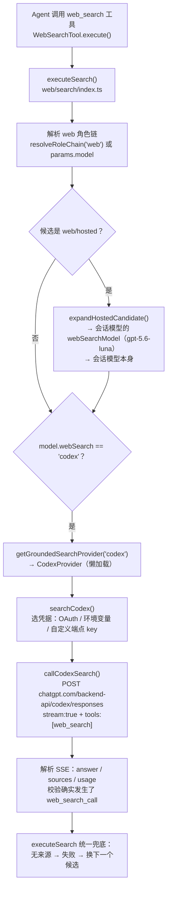

# oh-my-pi 如何使用 Codex 订阅的 web_search —— 源码分析

> 2026-10-22。分析对象：[can1357/oh-my-pi](https://github.com/can1357/oh-my-pi) `main@0b5c27a`（2026-10-22 浅克隆到 `reference/oh-my-pi/`，已被 `.gitignore` 忽略）。
> 目的：弄清它借用 ChatGPT（Codex）订阅联网搜索的具体做法，与本项目（subscription-powers）的路径 A 对照，看有哪些可以借鉴。

## 0. 一句话结论

oh-my-pi **不启动 `codex` CLI**，走的是我们在 `analysis-and-plan.zh.md` §2 里明确否决的**路径 C**：它自己完成 ChatGPT OAuth 登录（复用 Codex CLI 的 `client_id`），拿到 access token 后**直接向 `https://chatgpt.com/backend-api/codex/responses` 发 SSE 请求**。请求里挂上 OpenAI 托管的 `{"type":"web_search"}` 工具，并用 `tool_choice` 强制模型必须搜索，然后自己解析事件流，得到答案和来源。

---

## 1. 调用链总览



| 层 | 文件 | 作用 |
|---|---|---|
| 工具入口 + 候选链 | `packages/coding-agent/src/web/search/index.ts` | `executeSearch()` 按顺序遍历候选，失败就换下一个 |
| 懒加载注册表 | `packages/coding-agent/src/web/search/provider.ts` | `GROUNDED_PROVIDER_LOADERS.codex → CodexProvider` |
| **Codex 适配器** | `packages/coding-agent/src/web/search/providers/codex.ts`（683 行） | 选凭据、构造请求、解析 SSE |
| 后端常量 / 请求头 | `packages/catalog/src/wire/codex.ts` | `CODEX_BASE_URL`、伪装的客户端版本号、`chatgpt-account-id`、驻留区头 |
| URL 规整 | `packages/ai/src/providers/openai-codex-responses.ts:4954` | `resolveCodexResponsesUrl()` → `…/codex/responses` |
| OAuth 登录 | `packages/catalog/src/compat/rules/auth/openai-codex.kdl` + `packages/ai/src/registry/oauth/openai-codex.ts` | PKCE 浏览器登录 / 设备码登录 / 刷新 token |
| 模型声明 | `packages/catalog/src/compat/rules/providers/openai-codex.kdl` | `web-search "codex"`：这个 provider 下的模型都带 codex grounding |

---

## 2. 凭据从哪来：oh-my-pi 自己登录 ChatGPT

**它不读取 `~/.codex/auth.json`。** 源码里出现的 `.codex` 只用于发现配置目录（skills、agents 之类，见 `coding-agent/src/config.ts:14`），和认证无关。凭据有以下三种来源：

1. **浏览器 OAuth（PKCE）**：在 `auth/openai-codex.kdl` 里声明。
   - `client_id = app_EMoamEEZ73f0CkXaXp7hrann`：就是官方 Codex CLI 的 client id。
   - 授权地址 `https://auth.openai.com/oauth/authorize`，scope 为 `openid profile email offline_access api.connectors.read api.connectors.invoke`。
   - 额外参数 `id_token_add_organizations=true`、`codex_cli_simplified_flow=true`、`originator=omp`。
   - 回调地址固定为 `http://localhost:1455/auth/callback`（OpenAI 只允许这一个 URI；端口被占用时直接失败，不会换端口）。
   - 换 token 用 `https://auth.openai.com/oauth/token`。登录后会从 JWT 的 `https://api.openai.com/auth` claim 中解析出 `chatgpt_account_id`、`chatgpt_plan_type` 和 email。
2. **设备码登录**（`loginOpenAICodexDevice`，无头环境用）：`/api/accounts/deviceauth/usercode` → 轮询 `/deviceauth/token`。
3. **环境变量** `OPENAI_CODEX_OAUTH_TOKEN`：直接给一个 bearer token。

登录结果存放在 oh-my-pi 自己的 `agent.db` 中，过期后由通用刷新引擎用 refresh_token 自动刷新（`withOAuthAccess`）。存储层还支持**多账号轮换**：轮换后的 access token 可能对应不同的 `chatgpt_account_id`，所以每次重试都会重新取 token 和 account id（`codex.ts` 中 `runSearch` 的注释）。

## 3. 什么时候会用到 Codex 搜索

`web_search` 是 oh-my-pi 内置的单一工具，背后有一条 **`web` 角色候选链**：

- **默认链**（`compat/rules/runtime/behavior.kdl:467`）：`web/parallel` → **`web/hosted`** → `web/exa` → `web/firecrawl` → `web/searxng` → … → `web/mojeek`。
- **`web/hosted` 是占位符**，含义是“用当前会话模型所在 provider 自带的托管搜索”。`expandHostedCandidate()` 会把它展开成两个候选：
  1. 会话模型的 `webSearchModel`。catalog 中所有 `openai-codex/*` 聊天模型（gpt-5.6-sol、gpt-6-sol、gpt-6.1-sol……）都配置成 **`gpt-5.6-luna`**，也就是用更便宜的小模型搜索；
  2. 会话模型本身（第 1 个失败时兜底）。
- 所以：**会话模型是 Codex 订阅模型时，搜索自动走 Codex 订阅**，按订阅额度计费。
- 也可以显式指定：在配置里设 `modelRoles.web = "openai-codex/gpt-5.6-luna"`，或者单次调用 `omp q --model openai-codex/… "…"`。
- 可用性判断（`hasCodexSearch`）很宽松：只要 `openai-codex` 这个 provider 有任何凭据来源（OAuth 记录或环境变量）就算可用。

## 4. 请求本身（`callCodexSearch`，`codex.ts:350`）

**URL**：`resolveCodexResponsesUrl(model.baseUrl)`，默认是 `https://chatgpt.com/backend-api/codex/responses`。

**请求头**（`buildCodexHeaders`，`codex.ts:291`）：

| 头 | 值 | 说明 |
|---|---|---|
| `Authorization` | `Bearer <ChatGPT OAuth access_token>` | 会先删掉 `x-api-key` |
| `chatgpt-account-id` | JWT 中的 `chatgpt_account_id` | 指定从哪个订阅（workspace）扣额度 |
| `x-openai-internal-codex-residency` | JWT 中的 `chatgpt_data_residency` | 只有锁定了区域的企业 workspace 才发，否则会 401 |
| `OpenAI-Beta` | `responses=experimental` | |
| `originator` | `omp` | 如实标明自己是 oh-my-pi |
| `version` | `0.159.0` | **固定的 Codex CLI 版本号**。后端按这个值决定哪些模型可用，太旧会看不到新模型；仓库里有 `check-spoofed-versions` 脚本负责跟随 npm 上的版本 |
| `User-Agent` / `Accept` / `Content-Type` | omp UA / `text/event-stream` / `application/json` | |

**请求体**：

```jsonc
{
  "model": "gpt-5.6-luna",                 // 候选模型 id
  "stream": true,
  "store": false,
  "include": ["web_search_call.action.sources"],   // 让后端把检索到的来源也返回
  "parallel_tool_calls": true,
  "input": [{ "type": "message", "role": "user",
              "content": [{ "type": "input_text", "text": "<query>" }] }],
  "tools": [{ "type": "web_search", "search_context_size": "high" }],
  "tool_choice": { "type": "web_search" }, // 强制必须调用搜索
  "instructions": "<web-search 系统提示>"
}
```

**查询改写**：ChatGPT 后端用的是没有公开文档的 codex-rs 请求格式，不能指望 `web_search.filters.allowed_domains` 生效。所以 query 中带 `site:`、`filetype:`、`after:` 这类指令时，会按 Google 语法重新拼进查询文本（`formatQuery(parsed, GOOGLE_QUERY_SYNTAX)`）；不带指令的 query 原样发送。`recency`、`max_tokens`、`temperature` 都会被忽略。

## 5. 解析 SSE 响应

逐条读取 SSE JSON（`readSseJson`）：

| 事件 | 处理 |
|---|---|
| `response.web_search_call.*` | 标记 `webSearchInvoked = true` |
| `response.created` | 记录 `requestId` 和实际使用的 `model` |
| `response.output_text.delta` | 拼成流式答案（备用） |
| `response.output_item.done` + `item.type=web_search_call` | 从 `action.sources` / `sources` / `results` 三处收集来源 |
| `response.output_item.done` + `item.type=message` | 收集 `output_text` 作为最终答案；从 `url_citation` 注解中取来源，并截取引用位置前后约 100 字符作为 snippet |
| `response.output_item.done` + `item.type=reasoning` | 推理摘要 `summary_text` 也拼进答案 |
| `response.completed` / `response.done` | 记录 usage：`inputTokens` 会**扣除 cached_tokens** |
| `error` / `response.failed` | 兼容三种错误包装格式，并根据文本把错误归为 429/401/403/504/500 |

**收尾时的防护**：

1. **流里没有出现过任何 `web_search_call` 就报错 502**（`codex.ts:515`）：这样的回答来自模型自身知识，不能当作搜索结果返回（对应 issue #6988）。
2. **只返回图片占位文本**（如 "see attached image"）且没有来源时报错 502，交给下一个候选。
3. **没有 `url_citation` 注解时的来源兜底**：从答案中提取 markdown 链接和裸 URL，并清理末尾标点和不配对的括号。
4. **来源去重和清洗**：删掉 OpenAI 附加的 `utm_source=openai` 参数；同一 URL 合并时保留更好的 title 和 snippet。
5. 按 `num_search_results ?? limit` 在本地截断来源数量。

外层 `executeSearch()` 还有一层通用兜底：grounded 模型返回的结果**既没有来源也没有引用**时视为失败（`index.ts:271`），记录失败原因后换下一个候选；全部失败则返回 `All web search providers failed: …`。每个 provider 的硬超时由 `providers.webSearchTimeoutSeconds` 控制（默认 60 s，最大 300 s）。

## 6. 凭据安全边界

- **不把官方 OAuth token 发给第三方端点**：模型的 `baseUrl` 不是官方 ChatGPT 后端（`customEndpoint`）、凭据又来自 OAuth 或环境变量时，直接拒绝（`codex.ts:593`），要求为该 provider 配置 API key。这样把 provider 指到中转后，订阅 token 不会泄露过去。
- 自定义端点只能使用 API key 或命令生成的 key（`withAuth`）。
- 只有一个环境变量 token、没有存储记录时，改用 registry resolver，并从 JWT 中解析 account id。
- `OPENAI_CODEX_OAUTH_TOKEN` 和 `openai`（按量计费的 API）是两个独立的 provider，互不借用凭据（`openai.ts` 明确拒绝 OAuth）。

---

## 7. 与 subscription-powers 的对照

| 维度 | oh-my-pi | subscription-powers（`codex_web_search`） |
|---|---|---|
| 接入方式 | 直接 HTTP 调 `chatgpt.com/backend-api/codex/responses` | 子进程 `codex --search exec --json` |
| 凭据 | 自己 OAuth 登录，复用 Codex CLI 的 client_id，token 存 `agent.db` | 不碰凭据，由 CLI 使用 `~/.codex` |
| 客户端身份 | `originator: omp` + 固定的 `version: 0.159.0` | 就是官方 CLI |
| 是否强制搜索 | `tool_choice: {type:"web_search"}`，由协议保证 | 只靠提示词（"Use ONLY the built-in web_search tool"） |
| 搜索深度 | `search_context_size: "high"` | CLI 默认值 |
| 来源 | 结构化：`action.sources` + `url_citation` 注解 + 文本兜底 | 用正则从最终答案中提取 URL |
| 没搜索时 | 报错，交给下一个 provider | 仍然返回 `ok: true`，`searches_made` 可能为空 |
| 时延 | 一次 HTTP 流，没有冷启动 | 每次冷启动 CLI，约 5–10 s |
| 跟随后端变化 | 要维护私有协议、版本号、请求头，后端一改就可能失效 | 跟着 CLI 升级 |
| 合规风险 | 较高：无文档接口，模拟官方客户端 | 低：走官方产品 |

## 8. 对本项目的启示

**不建议照搬直连后端的做法**。理由和 `analysis-and-plan.zh.md` §2 否决路径 C 时一样：私有接口、伪装版本号、OAuth 由第三方持有，都有违反条款和封号的风险。oh-my-pi 自己也需要持续维护 `check-spoofed-versions`、驻留区头、多种错误格式这类适配代码，可见这条路成本不低。

以下几点**不改变路径 A** 也能借鉴到 `server/lib/codex.mjs` 的 `webSearch()` 中：

1. **没搜索就算失败**：`o.ev.searches.length === 0` 时返回 `ok: false`（或至少加一条 warning），不要把模型凭记忆写的答案当成搜索结果。这和 oh-my-pi 的 #6988 是同一个问题。
2. **清洗来源 URL**：去掉 `utm_source=openai`，处理 markdown 链接 `[title](url)` 中的括号配对和末尾标点，同时保留 title。现在的 `URL_RE` 会把 title 丢掉。
3. **查询指令透传**：在提示词中说明，query 里的 `site:`、`filetype:`、`after:` 要原样用在搜索中。
4. **usage 扣除缓存**：如果 `codex exec --json` 的 `turn.completed.usage` 带有 `cached_input_tokens`，可以像 oh-my-pi 那样单独列出，方便调用方估算真实消耗。
5. 可以把 `codex --search exec` 的 `-c` 配置项（如 `model_reasoning_effort`）或 `--model` 指到更便宜的小模型专门做搜索，对应 oh-my-pi 的 `webSearchModel = gpt-5.6-luna` 设计，从而节省订阅额度。需要先实测 CLI 是否支持该模型。

## 9. 源码索引（`reference/oh-my-pi/`）

- `packages/coding-agent/src/web/search/providers/codex.ts`
  - `:291` `buildCodexHeaders`
  - `:350` `callCodexSearch`（`:367` 请求体，`:386` `tool_choice`，`:515` 拒绝没有搜索的回答）
  - `:556` `searchCodex`（`:566` 查询改写，`:593` 拒绝把 OAuth 发给自定义端点）
  - `:667` `hasCodexSearch`
- `packages/coding-agent/src/web/search/index.ts`：`:142` `expandHostedCandidate`，`:168` `executeSearch`，`:271` 无来源即失败
- `packages/coding-agent/src/web/search/provider.ts`：`GROUNDED_PROVIDER_LOADERS`
- `packages/catalog/src/wire/codex.ts`：`CODEX_BASE_URL`、`:34` `CODEX_CLIENT_VERSION`、`:71` `ORIGINATOR_CODEX="omp"`、`getCodexAccountId`、`getCodexResidency`
- `packages/catalog/src/compat/rules/auth/openai-codex.kdl`：OAuth 登录和刷新声明
- `packages/catalog/src/compat/rules/providers/openai-codex.kdl`：`web-search "codex"`、`env "OPENAI_CODEX_OAUTH_TOKEN"`
- `packages/ai/src/registry/oauth/openai-codex.ts`：PKCE URL、换 token、设备码流程、JWT 身份解析
- `packages/coding-agent/test/web/search/codex-broker.test.ts`：最小 SSE 样例（请求 URL、请求头、请求体的断言）
- `docs/tools/web_search.md`、`docs/provider-quirks.md` §OpenAI Codex：官方文档
